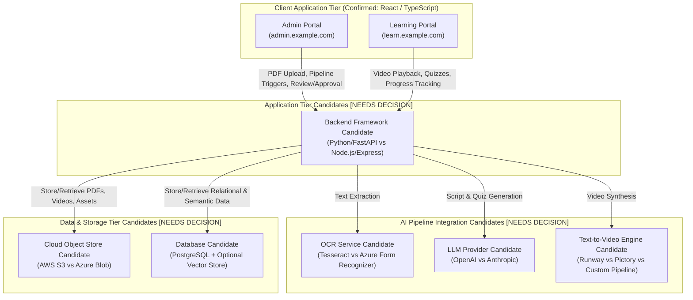
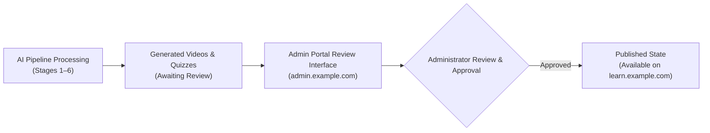
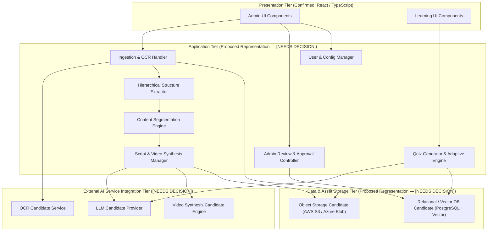
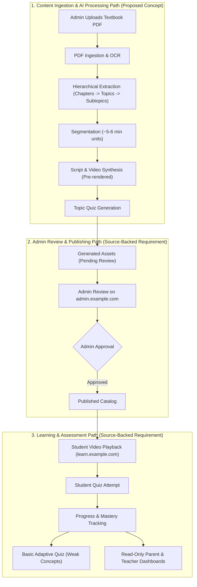

# 03 — System Architecture Specification

## 1. Document Information & Architectural Governance
- **Document Title:** System Architecture Specification
- **Document Version:** 1.0 (Baseline)
- **Status:** Proposed Architecture Baseline — Pending Review
- **Author:** System Architecture Architect
- **Source Baselines:** `README.md`, locked `docs/01_PRD.md` (v1.0), and locked `docs/02_REQUIREMENTS.md` (v1.2)

### 1.1 Governance & Architectural Classification Framework
To preserve strict alignment with authoritative sources, all architectural elements in this specification are classified into three distinct categories:
1. **Source-Backed Requirements (Confirmed)**: Capabilities, constraints, and technologies explicitly defined in `README.md`, `01_PRD.md`, and `02_REQUIREMENTS.md`. These include:
   - Dual-application portal architecture (`admin.example.com` and `learn.example.com`)
   - 6-stage AI pipeline flow
   - Pre-rendered video unit delivery targeting 5–6 minutes
   - Administrator review/approval workflow prior to publishing
   - 8 core MVP features (Phase 1)
   - React (TypeScript) frontend framework with component libraries
2. **Proposed Architecture (Pending Approval)**: Conceptual subsystem groupings, internal component layouts, and data flow representations. These serve as illustrative design patterns for future implementation and do not represent finalized or locked engineering decisions.
3. **Open Technology Decisions (`[NEEDS DECISION]`)**: Candidate technologies explicitly listed in the source documents as pending or to be finalized. No backend framework, AI service provider, cloud storage provider, or database engine is chosen in this document.

## 2. High-Level Architectural Overview (Proposed Architecture — Pending Approval)

### 2.1 Dual-Portal Domain Architecture
The platform is structured around two user-facing web entry points:
- **Admin Portal (`admin.example.com`)**: Serves administrators for textbook PDF uploading, AI pipeline triggering, reviewing/approving generated videos and quizzes, user management, and configuration of mastery thresholds and adaptive settings.
- **Learning Portal (`learn.example.com`)**: Serves students for video playback, quiz execution, progress tracking, and quiz attempts; serves parents and teachers with read-only dashboards to monitor student progress and track mastery.

### 2.2 Conceptual System Boundary Diagram (Proposed — Subject to Approval)
The diagram below illustrates the conceptual boundary between user portals, application services, processing engines, storage options, and external AI service candidates:

## 3. End-to-End AI Pipeline Architecture (6 Stages)

The core processing pipeline follows the six stages specified in the source baselines:

1. **Stage 1: PDF Ingestion & OCR**
   - Ingests textbook PDF files uploaded via the Admin portal.
   - Extracts raw text and visual contents via Candidate OCR Engine (`[NEEDS DECISION]`: Tesseract vs Azure Form Recognizer).

2. **Stage 2: Hierarchical Extraction**
   - Parses extracted content into a structured hierarchy consisting of chapters → topics → subtopics.

3. **Stage 3: Intelligent Content Segmentation**
   - Segments hierarchical content into discrete learning units targeting ~5–6 minutes of video duration.

4. **Stage 4: Script Generation → Video Synthesis**
   - Generates video scripts from segmented content using Candidate LLM (`[NEEDS DECISION]`: OpenAI vs Anthropic).
   - Synthesizes pre-rendered 5–6 minute learning videos via Candidate Text-to-Video Engine (`[NEEDS DECISION]`: Runway vs Pictory vs Custom pipeline).

5. **Stage 5: Quiz Generation**
   - Automatically generates quizzes per topic aligned to topic learning objectives.

6. **Stage 6: Adaptive Quiz Regeneration**
   - Triggers basic adaptive quiz regeneration (generating new questions for weak concepts) based on student quiz attempt performance.

## 4. Governance & Publishing Workflow (Admin Review Gate)

The platform requires an administrator review and approval workflow before generated content is published:

- **Publishing Requirement**: Generated videos and quizzes undergo administrator review in the Admin portal (`admin.example.com`) prior to being published for consumption on the Learning portal (`learn.example.com`).

## 5. Portal Subsystems & User Experience Scopes

### 5.1 Admin Portal Subsystems (`admin.example.com`)
- **PDF Upload & Ingestion Interface**: Allows administrators to upload textbook PDFs.
- **Pipeline Execution & Triggering Workspace**: Enables administrators to trigger the AI extraction and generation pipeline.
- **Content Review & Approval Workspace**: Provides interface for administrators to review and approve generated videos and quizzes prior to publication.
- **User Management Workspace**: Enables administrators to manage platform users.
- **Threshold & Adaptive Settings Configurator**: Enables administrators to configure mastery thresholds and adaptive assessment parameters.

### 5.2 Learning Portal Subsystems (`learn.example.com`)
- **Student Learning Workspace**: Provides students with pre-rendered video playback, progress tracking, and topic quiz execution.
- **Student Adaptive Remediation View**: Delivers basic adaptive quiz attempts targeting weak concepts based on performance.
- **Parent Read-Only Dashboard**: Provides parents with read-only progress and mastery monitoring.
- **Teacher Read-Only Dashboard**: Provides teachers with read-only progress and mastery monitoring.

## 6. Conceptual System Component Architecture (Proposed — Subject to Approval)

The conceptual diagram below illustrates proposed internal component boundaries across tiers. All internal abstractions are proposed design representations subject to future technical selection:

## 7. Conceptual Data Flow Architecture (Proposed — Subject to Approval)

The conceptual data flow below illustrates illustrative processing paths for content ingestion, admin approval, and student learning. These mechanisms represent proposed design abstractions:

## 8. Technology Stack & Open Architectural Decisions

The table below lists technology choices specified in locked source documents versus open candidate decisions:

| Component / Layer | Technology Choice / Candidates | Status | Source Basis |
|---|---|---|---|
| Frontend Framework | React (TypeScript) with component libraries | Specified / Confirmed | PRD NFR-004 (Sec 13), SRS Sec 5, README line 64 |
| Backend Architecture | Python (FastAPI) vs Node.js (Express) | `[NEEDS DECISION]` | PRD NFR-003 (Sec 13) & Sec 18, SRS Sec 5, README line 63 |
| OCR Service | Tesseract vs Azure Form Recognizer | `[NEEDS DECISION]` | PRD NFR-005 (Sec 13) & Sec 18, SRS Sec 5, README line 65 |
| LLM Provider | OpenAI vs Anthropic | `[NEEDS DECISION]` | PRD NFR-006 (Sec 13) & Sec 18, SRS Sec 5, README line 65 |
| Text-to-Video Engine | Runway vs Pictory vs Custom pipeline | `[NEEDS DECISION]` | PRD NFR-007 (Sec 13) & Sec 18, SRS Sec 5, README line 65 |
| Cloud Object Storage | AWS S3 vs Azure Blob | `[NEEDS DECISION]` | PRD NFR-008 (Sec 13) & Sec 18, SRS Sec 5, README line 66 |
| Database Strategy | PostgreSQL (relational) + optional vector store | `[NEEDS DECISION]` | PRD NFR-009 (Sec 13) & Sec 18, SRS Sec 5, README line 67 |

## 9. Roadmap Scope Mapping (Phase 1 MVP vs. Phases 2–4)

To ensure architecture alignment across implementation phases:

- **Phase 1 (MVP Architecture)**:
  - Dual portals (`admin.example.com` & `learn.example.com`)
  - 6-stage AI pipeline implementation
  - Pre-rendered 5–6 min video generation & playback
  - Auto-generated topic quizzes
  - Admin review workflow before publishing
  - Student portal with video playback, progress tracking, and quiz attempts
  - Basic adaptive quizzes (new questions for weak concepts)
  - Read-only parent & teacher dashboards
  - Configurable mastery thresholds and adaptive settings

- **Phase 2 Architecture (Post-MVP)**:
  - Adaptive quiz engine enhancements
  - Advanced teacher & parent analytics

- **Phase 3 Architecture (Post-MVP)**:
  - Advanced AI refinements
  - Video streaming CDN
  - Multi-language support

- **Phase 4 Architecture (Post-MVP)**:
  - System scaling topology
  - Automated CI/CD pipelines
  - System monitoring
  - Security hardening

## 10. Open Decisions & Future Detailed Design Work

### 10.1 Unresolved Technology Decisions (`[NEEDS DECISION]`)
1. **Backend Framework**: Decision pending between Python (FastAPI) and Node.js (Express).
2. **OCR Engine**: Decision pending between Tesseract and Azure Form Recognizer.
3. **LLM Provider**: Decision pending between OpenAI and Anthropic.
4. **Text-to-Video Synthesis Engine**: Decision pending between Runway, Pictory, and a custom pipeline.
5. **Cloud Object Storage**: Decision pending between AWS S3 and Azure Blob Storage.
6. **Database Strategy**: Decision pending on database configuration (PostgreSQL relational database with optional vector store for semantic retrieval).

### 10.2 Future Detailed Design Work (Deferred to Dedicated Documents)
- **Detailed Database Schema & Data Models**: To be defined in a dedicated database design document after database technology decisions are made.
- **API Specifications & Interface Contracts**: To be defined in a dedicated API design document after backend framework decisions are made.
- **Infrastructure, CI/CD & Security Architecture**: Deferred to Phase 4 per the high-level roadmap.

---

## 11. System Architecture Verification Checklist

- [x] Preserved dual-portal architecture (`admin.example.com` and `learn.example.com`)
- [x] Represented full 6-stage AI pipeline
- [x] Integrated admin review workflow prior to publishing pre-rendered videos and quizzes without unstated rejection paths
- [x] Maintained all 8 MVP features in Phase 1 without reclassifying basic adaptive quizzes or read-only dashboards
- [x] React (TypeScript) frontend marked Confirmed (PRD NFR-004); all 6 technology candidates marked `[NEEDS DECISION]`
- [x] Component diagram repaired with `Sub_Ingest --> Sub_Hierarchy` connection
- [x] Traceability matrix explicitly cites exact PRD NFR identifiers (NFR-003 to NFR-009) and PRD Section 18
- [x] Status set to `Proposed Architecture Baseline — Pending Review`
- [x] Diagrams explicitly labeled as Conceptual Proposals and syntactically validated
- [x] Database schemas and API specifications deferred to future detailed design work
