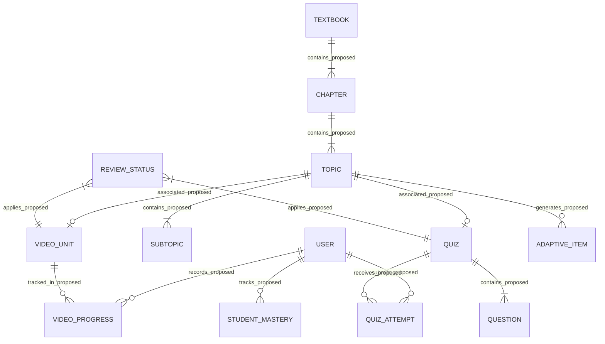

# 04 — Database Conceptual Design Specification

## 1. Document Information
- **Document Title:** Database Conceptual Design Specification
- **Document Version:** 1.0 (Draft / Proposed)
- **Status:** Proposed Conceptual Model — Pending Review
- **Author:** Database Architect
- **Source Baselines:** `README.md`, locked `docs/01_PRD.md` (v1.0), locked `docs/02_REQUIREMENTS.md` (v1.2), and locked `docs/03_SYSTEM_ARCHITECTURE.md` (v1.0)
- **Purpose:** Defines the conceptual data model and persistent data requirements for the platform based on authoritative source requirements, without finalizing database technology, physical schemas, or DDL script implementations.

## 2. Database Scope
The persistent database layer must support the core Phase 1 MVP capabilities defined across the source documents:
1. Ingestion and storage tracking for textbook PDFs and AI-extracted contents.
2. Hierarchical structure tracking (Chapters → Topics → Subtopics).
3. Metadata and asset references for pre-rendered short (5–6 min) learning video units and generated scripts.
4. Auto-generated topic quizzes aligned to learning objectives.
5. Admin review and approval tracking prior to content publication.
6. User identity management across user roles (Administrators, Students, Parents, Teachers).
7. Student video playback progress tracking, quiz attempts, overall progress tracking, and performance score recording.
8. Basic adaptive quiz generation tracking (targeting weak concepts).
9. Configurable mastery thresholds and adaptive assessment parameter settings.
10. Read-only dashboard progress & mastery data aggregation for parents and teachers.

Deferred to Phase 2 (Post-MVP): Advanced adaptive quiz engine infrastructure data models, advanced parent/teacher analytics data models.

## 3. Confirmed Data Requirements
The following categories of persistent data are derived directly from the source baselines:

- **CDR-001 (User & Account Data)**: Account profiles and role assignments for Administrators, Students, Parents, and Teachers (`PRD FR-008`, `SRS REQ-FR-009`).
- **CDR-002 (Textbook PDF & Ingestion Metadata)**: Document metadata for uploaded textbook PDFs (`PRD FR-001`, `SRS REQ-FR-001`).
- **CDR-003 (Hierarchical Structure Data)**: Structural representations mapping extracted content into Chapters, Topics, and Subtopics (`PRD FR-003`, `SRS REQ-FR-003`).
- **CDR-004 (Video & Script Asset Metadata)**: Script text and video asset references for pre-rendered ~5–6 minute learning video units (`PRD FR-004, FR-005`, `SRS REQ-FR-004, REQ-FR-005`).
- **CDR-005 (Topic Quiz & Question Data)**: Auto-generated topic quizzes aligned to topic learning objectives (`PRD FR-006`, `SRS REQ-FR-006`).
- **CDR-006 (Admin Review & Approval Status)**: Review state tracking (e.g., pending review, approved/published) for generated videos and quizzes (`PRD FR-007`, `SRS REQ-FR-008`).
- **CDR-007 (Student Attempt & Video Playback Progress Data)**: Records of student video consumption/playback progress, quiz attempt submissions, concept scores, and progress tracking (`PRD FR-010`, `SRS REQ-FR-011`).
- **CDR-008 (Basic Adaptive Quiz Data)**: System-generated adaptive quiz items targeting weak concepts based on student performance (`PRD FR-011`, `SRS REQ-FR-007`).
- **CDR-009 (Mastery Thresholds & System Settings)**: Configurable threshold values and adaptive assessment configuration settings (`PRD FR-009`, `SRS REQ-FR-010`).
- **CDR-010 (Read-Only Performance & Mastery Views)**: Aggregated progress and concept mastery records accessible via read-only dashboards for parents and teachers (`PRD FR-012`, `SRS REQ-FR-012`).

## 4. Conceptual Data Model (Proposed — Subject to Approval)

The conceptual data model establishes the logical entities required to fulfill the confirmed and proposed data requirements. Each entity is designated as either **Confirmed Requirement** (direct mapping to source capabilities) or **Proposed Concept** (logical abstraction for data organization).

*(Note: Entity relationships and cardinalities depicted in the diagram below represent proposed conceptual assumptions for discussion and pending physical validation. They do not constitute confirmed relational database constraints.)*

### 4.1 Logical Entity Definitions

1. **User (`E-USER`)**
   - **Purpose**: Represents platform users across all four source-defined roles (Student, Parent, Teacher, Administrator).
   - **Source Requirement**: `PRD Sec 6`, `PRD FR-008`, `SRS REQ-FR-009`.
   - **Classification**: Confirmed Requirement.

2. **Textbook Document (`E-TEXTBOOK`)**
   - **Purpose**: Stores metadata for ingested textbook PDF files.
   - **Source Requirement**: `PRD FR-001`, `SRS REQ-FR-001`.
   - **Classification**: Confirmed Requirement.

3. **Content Hierarchy (Chapter, Topic, Subtopic) (`E-HIERARCHY`)**
   - **Purpose**: Logical structure organizing textbook content into Chapters, Topics, and Subtopics.
   - **Source Requirement**: `PRD FR-003`, `SRS REQ-FR-003`.
   - **Classification**: Confirmed Requirement.

4. **Video Learning Unit (`E-VIDEO`)**
   - **Purpose**: Metadata and storage references for pre-rendered ~5–6 minute learning videos and generated scripts.
   - **Source Requirement**: `PRD FR-004, FR-005`, `SRS REQ-FR-004, REQ-FR-005`, `Arch Sec 3`.
   - **Classification**: Confirmed Requirement.

5. **Video Playback Progress (`E-VIDEO-PROGRESS`)**
   - **Purpose**: Captures student video playback consumption progress (e.g., video completion state and playback tracking).
   - **Source Requirement**: `PRD FR-010`, `SRS REQ-FR-011` (Student video playback & progress tracking).
   - **Classification**: Proposed Concept (Specific tracking granularity, e.g. timestamp offsets vs completion percentages, remains `[NEEDS CONFIRMATION]`).

6. **Quiz & Question (`E-QUIZ`, `E-QUESTION`)**
   - **Purpose**: Topic-aligned quiz definitions, questions, and learning objective associations.
   - **Source Requirement**: `PRD FR-006`, `SRS REQ-FR-006`.
   - **Classification**: Confirmed Requirement.

7. **Content Review Status (`E-REVIEW-STATUS`)**
   - **Purpose**: Logical tracking of admin review and approval state prior to publishing content.
   - **Source Requirement**: `PRD FR-007`, `SRS REQ-FR-008`, `Arch Sec 4`.
   - **Classification**: Confirmed Requirement.

8. **Quiz Attempt (`E-QUIZ-ATTEMPT`)**
   - **Purpose**: Student-submitted quiz responses, scores, and timestamps.
   - **Source Requirement**: `PRD FR-010`, `SRS REQ-FR-011`.
   - **Classification**: Confirmed Requirement.

9. **Student Progress & Mastery (`E-MASTERY`)**
   - **Purpose**: Tracks concept mastery scores, weak concept flags, and overall progress; consumed by student, parent, and teacher views.
   - **Source Requirement**: `PRD FR-010, FR-012`, `SRS REQ-FR-011, REQ-FR-012`.
   - **Classification**: Confirmed Requirement.

10. **Adaptive Assessment Recommendation (`E-ADAPTIVE-ITEM`)**
    - **Purpose**: Logical representation of basic adaptive quiz questions generated for weak concepts.
    - **Source Requirement**: `PRD FR-011`, `SRS REQ-FR-007`.
    - **Classification**: Confirmed Requirement.

11. **System Settings & Mastery Thresholds (`E-SYSTEM-SETTINGS`)**
    - **Purpose**: Administrator-configurable mastery threshold parameters and adaptive quiz settings.
    - **Source Requirement**: `PRD FR-009`, `SRS REQ-FR-010`.
    - **Classification**: Confirmed Requirement (Configuration scope, i.e., global platform settings vs per-user/tenant settings, remains `[NEEDS DECISION]`).

## 5. Data Lifecycle and Relationships

The data lifecycle reflects the high-level flow of persistent information through the system:

1. **Ingestion & Extraction Lifecycle Stage**:
   - Administrator uploads a textbook PDF via `admin.example.com`.
   - `E-TEXTBOOK` entry created.
   - Hierarchical structure (`E-HIERARCHY`: Chapters → Topics → Subtopics) is generated and linked to `E-TEXTBOOK`.

2. **Synthesis & Generation Lifecycle Stage**:
   - Segmented topic units generate `E-VIDEO` (scripts and pre-rendered video references).
   - Topic learning objectives generate `E-QUIZ` and `E-QUESTION` items.
   - Content items enter `E-REVIEW-STATUS` (awaiting admin review).

3. **Admin Review & Publishing Lifecycle Stage**:
   - Administrator reviews `E-VIDEO` and `E-QUIZ` assets via `admin.example.com`.
   - Upon approval, `E-REVIEW-STATUS` transitions to Published state, exposing content on `learn.example.com`.

4. **Learning & Assessment Lifecycle Stage**:
   - Student watches `E-VIDEO` units (recording playback progress in `E-VIDEO-PROGRESS`) and submits `E-QUIZ-ATTEMPT`.
   - System updates `E-MASTERY` performance scores.
   - Weak concepts identified in `E-MASTERY` trigger `E-ADAPTIVE-ITEM` generation for basic adaptive remediation.

5. **Monitoring Lifecycle Stage**:
   - Parents and teachers access read-only views of `E-MASTERY` progress and score records on `learn.example.com`.

## 6. Access and Usage Requirements

Access to persistent data entities distinguishes source-confirmed permissions from proposed access rules and unresolved items (`[NEEDS CONFIRMATION]`):

| Data Category / Entity | Administrator (`admin.example.com`) | Student (`learn.example.com`) | Parent (`learn.example.com`) | Teacher (`learn.example.com`) | Permission Status |
|---|---|---|---|---|---|
| User Accounts (`E-USER`) | Read / Write (User Management) | Self-Read | `[NEEDS CONFIRMATION]` | `[NEEDS CONFIRMATION]` | Confirmed (Admin/Student) / Proposed (Parent/Teacher) |
| Textbook & Hierarchy (`E-TEXTBOOK`, `E-HIERARCHY`) | Read / Write / Upload | Read (Published Content) | `[NEEDS CONFIRMATION]` | `[NEEDS CONFIRMATION]` | Confirmed (Admin/Student) / Proposed (Parent/Teacher) |
| Videos & Quizzes (`E-VIDEO`, `E-QUIZ`, `E-QUESTION`) | Read / Write / Review / Approve | Read / Play / Execute (Published) | `[NEEDS CONFIRMATION]` | `[NEEDS CONFIRMATION]` | Confirmed (Admin/Student) / Proposed (Parent/Teacher) |
| Review Status (`E-REVIEW-STATUS`) | Read / Write (Approve/Publish) | None | None | None | Confirmed (Admin Gate) |
| Video Playback Progress (`E-VIDEO-PROGRESS`) | Read / Audit | Read / Write (Playback Progress) | `[NEEDS CONFIRMATION]` | `[NEEDS CONFIRMATION]` | Confirmed (Student) / Proposed (Parent/Teacher/Admin) |
| Quiz Attempts (`E-QUIZ-ATTEMPT`) | Read / Audit | Read / Write (Submit Attempts) | `[NEEDS CONFIRMATION]` | `[NEEDS CONFIRMATION]` | Confirmed (Student) / Proposed (Parent/Teacher/Admin) |
| Student Mastery & Progress Dashboard (`E-MASTERY`) | Read / Audit | Read (Personal Mastery) | Read-Only (Dashboard View) | Read-Only (Dashboard View) | Confirmed (Student/Parent/Teacher Read-Only Dashboard) |
| Adaptive Quiz Items (`E-ADAPTIVE-ITEM`) | Read / Config | Read / Execute (Weak Concepts) | `[NEEDS CONFIRMATION]` | `[NEEDS CONFIRMATION]` | Confirmed (Student) / Proposed (Parent/Teacher) |
| Mastery Threshold Settings (`E-SYSTEM-SETTINGS`) | Read / Write (Configure Thresholds) | None | None | None | Confirmed (Admin Config) |

*(Note: Detailed RBAC role matrices, row-level security policies, and token scopes are omitted as they are not defined in source documents and remain `[NEEDS DECISION]`.)*

## 7. Database Technology Decisions (`[NEEDS DECISION]`)

The selection of physical database technologies remains an open candidate decision per `README.md` (lines 67), `01_PRD.md` (Sec 18), `02_REQUIREMENTS.md` (Sec 5), and `03_SYSTEM_ARCHITECTURE.md` (Sec 8):

| Technology Candidate Area | Stated Source Options | Current Status |
|---|---|---|
| Primary Database Engine | PostgreSQL (Relational Database) | Candidate Option — `[NEEDS DECISION]` |
| Semantic Retrieval Store | Optional Vector Store (alongside PostgreSQL) | Candidate Option — `[NEEDS DECISION]` |

No database vendor, cloud database service provider (e.g., AWS RDS, Azure Database for PostgreSQL), or vector database technology (e.g., pgvector, Pinecone) has been selected or finalized.

## 8. Physical Schema Status (Deferred)

In accordance with Section 10.2 of `03_SYSTEM_ARCHITECTURE.md`, all physical database design artifacts are formally **DEFERRED** until database technology decisions are finalized:
- **Table Definitions & Column Data Types**: Deferred.
- **Primary Keys, Foreign Keys, & Constraints**: Deferred.
- **Index Strategies & Query Optimization**: Deferred.
- **Database Migration Scripts & DDL Specs**: Deferred.

No SQL scripts, DDL statements, or database-specific column definitions are provided in this conceptual specification.

## 9. Open Questions and Decisions

1. **Database Technology Selection**: Will PostgreSQL be used as the single relational database engine, or will a secondary vector store be incorporated? (`[NEEDS DECISION]`)
2. **Vector Store Necessity**: Is a vector store needed for the platform's retrieval needs, or can relational querying suffice? (`[NEEDS DECISION]`)
3. **Mastery Score Data Representation**: What exact mathematical format should be used to store mastery thresholds and score history? (`[NEEDS DECISION]`)
4. **Parent/Teacher Student Association**: How are parent-to-student and teacher-to-student data relationships linked at the account level? (`[NEEDS CONFIRMATION]`)
5. **Video Playback Progress Granularity**: Should video progress be recorded via timestamp offsets, percentage milestones, or simple completion flags? (`[NEEDS CONFIRMATION]`)
6. **System Configuration Scope**: Are mastery thresholds and adaptive assessment parameters configured as global platform settings or on a per-tenant/per-user basis? (`[NEEDS DECISION]`)

## 10. Traceability Matrix

| Data Requirement / Entity | PRD Source (`01_PRD.md`) | SRS Source (`02_REQUIREMENTS.md`) | Architecture Source (`03_SYSTEM_ARCHITECTURE.md`) | README Source |
|---|---|---|---|---|
| `E-USER` (User Account Data) | FR-008, Section 6 | REQ-FR-009, Section 2.1 | Section 5.1, Section 8 | Lines 13, 14 |
| `E-TEXTBOOK` (PDF Document) | FR-001, Section 7 (Stage 1) | REQ-FR-001, Section 3.1 | Section 3 (Stage 1), Section 5.1 | Lines 17, 25 |
| `E-HIERARCHY` (Chapters/Topics) | FR-003, Section 7 (Stage 2) | REQ-FR-003, Section 3.1 | Section 3 (Stage 2) | Line 18 |
| `E-VIDEO` (Video Units & Scripts) | FR-004, FR-005, Section 13 (NFR-001) | REQ-FR-004, REQ-FR-005, REQ-NFR-001 | Section 3 (Stages 3 & 4) | Lines 6, 19, 20, 26 |
| `E-VIDEO-PROGRESS` (Playback Progress) | FR-010, Section 8 | REQ-FR-011, Section 3.5 | Section 5.2 | Lines 14, 29 |
| `E-QUIZ`, `E-QUESTION` (Quizzes) | FR-006, Section 7 (Stage 5) | REQ-FR-006, Section 3.3 | Section 3 (Stage 5) | Lines 21, 27 |
| `E-REVIEW-STATUS` (Admin Gate) | FR-007, Section 8 | REQ-FR-008, CON-002 | Section 4, Section 5.1 | Lines 13, 28 |
| `E-QUIZ-ATTEMPT` (Student Attempts) | FR-010, Section 8 | REQ-FR-011, Section 3.5 | Section 5.2 | Lines 14, 29 |
| `E-MASTERY` (Progress & Mastery) | FR-010, FR-012 | REQ-FR-011, REQ-FR-012 | Section 5.2 | Lines 14, 29, 31 |
| `E-ADAPTIVE-ITEM` (Adaptive Quiz) | FR-011, Section 7 (Stage 6) | REQ-FR-007, Section 3.3 | Section 3 (Stage 6) | Lines 22, 30 |
| `E-SYSTEM-SETTINGS` (Thresholds) | FR-009, Section 8 | REQ-FR-010, Section 3.4 | Section 5.1 | Lines 13, 32 |
| Database Engine (`[NEEDS DECISION]`) | NFR-009, Section 18 | Section 5 (Table) | Section 8 (Table), Section 10.1 | Line 67 |

## 11. Validation Checklist

- [x] Grounded strictly in locked sources (`README.md`, `01_PRD.md` v1.0, `02_REQUIREMENTS.md` v1.2, `03_SYSTEM_ARCHITECTURE.md` v1.0)
- [x] All 8 MVP features represented conceptually (including basic adaptive quizzes, read-only parent/teacher dashboards, configurable thresholds)
- [x] Admin approval workflow preserved before publishing
- [x] Read-only restriction maintained for parent and teacher roles, with unconfirmed underlying entity access marked `[NEEDS CONFIRMATION]`
- [x] Mermaid ERD cardinalities and relationships explicitly labeled as proposed conceptual assumptions pending physical validation
- [x] Removed per-user settings ownership relationship from ERD; marked configuration scope `[NEEDS DECISION]`
- [x] Added `E-VIDEO-PROGRESS` as a proposed conceptual entity supporting student playback progress tracking
- [x] Neutral rephrasing of vector store retrieval question in Section 9
- [x] Verified exact PRD and SRS requirement mapping (PRD FR-007 / SRS REQ-FR-008 through PRD FR-012 / SRS REQ-FR-012)
- [x] Technology choices (PostgreSQL + optional vector store) preserved as `[NEEDS DECISION]`
- [x] Physical schemas, SQL DDL scripts, column types, and foreign key indexes explicitly deferred
- [x] Document status set to `Proposed Conceptual Model — Pending Review` and version kept as 1.0
