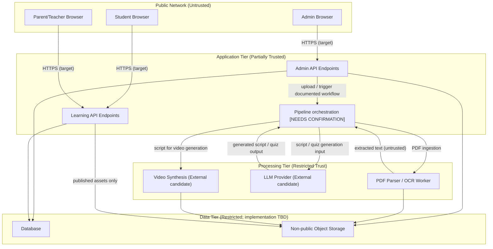

# 07 — Security Specification

## 1. Document Information
- **Document Title:** Security Specification
- **Document Version:** 1.0 (Draft / Proposed)
- **Status:** Proposed Security Specification — Pending Review
- **Author:** Security Architect
- **Source Baselines:** `README.md`, locked `docs/01_PRD.md` (v1.0), locked `docs/02_REQUIREMENTS.md` (v1.2), locked `docs/03_SYSTEM_ARCHITECTURE.md` (v1.0), approved `docs/04_DATABASE.md` (v1.0), `docs/05_API.md` (v1.0), and locked `docs/06_UI_UX.md` (v1.0).

### 1.1 Relationship to Source Roadmap
The locked PRD (Sec 16), SRS (Sec 8), and System Architecture (Sec 10.2) explicitly defer **security hardening** to Phase 4 of the project roadmap. This document does not override that phasing. Instead, it defines the **baseline MVP security requirements**, access-control rules, and risk mitigations that are necessary to operate the platform safely during Phase 1, and identifies the security decisions and hardening measures that remain deferred.

---

## 2. Purpose, Scope, and Security Principles

### 2.1 Purpose & Scope
This specification defines the baseline security architecture, access control policies, data privacy controls, input validation requirements, AI output trust model, and threat mitigations for the AI-Powered Textbook-to-Video Learning & Student Performance Platform during Phase 1 MVP.

- **System Scope**:
  - **Admin Portal (`admin.example.com`)**: High-privilege web application for uploading textbook PDFs, triggering the 6-stage AI processing pipeline, reviewing and approving generated content, managing user accounts, and configuring mastery thresholds (PRD Sec 7–8, Architecture Sec 5.1).
  - **Learning Portal (`learn.example.com`)**: Student interface for pre-rendered video playback, quiz execution, progress tracking, and basic adaptive remediation; parent/teacher interface for read-only progress and mastery summary monitoring (PRD Sec 8, Architecture Sec 5.2).
- **Phase Boundary**: This document covers Phase 1 MVP baseline security. Advanced security hardening (enterprise SSO, automated threat intelligence, penetration testing, multi-tenant isolation, advanced monitoring) is deferred to Phase 4 per the locked roadmap (PRD Sec 16, SRS Sec 8, Architecture Sec 10.2).

### 2.2 Core Security Principles
1. **Defense in Depth**: Layered security controls across authentication, authorization, API input validation, file parsing, AI output review, and storage encryption.
2. **Least Privilege & Role Isolation**: Each of the four platform roles (Administrator, Student, Teacher, Parent) receives the minimum permissions necessary for its documented capabilities. Administrative functions are restricted to `admin.example.com`.
3. **Zero Trust for AI Output**: All model-generated scripts, video metadata, and quiz questions are treated as untrusted content until an administrator explicitly inspects and approves them via the review-and-approval gate (PRD FR-007, SRS REQ-FR-008, Architecture Sec 4).
4. **Untrusted Input by Default**: Uploaded PDF textbooks, OCR-extracted text, and all user-submitted form data are treated as untrusted input requiring validation and sanitization before processing.
5. **Data Minimization**: Student performance telemetry is collected only as necessary to deliver the documented learning analytics and adaptive remediation capabilities.

---

## 3. Authentication and Session Security

### 3.1 Authentication Requirements by Role

The platform establishes four user roles (PRD Sec 6, SRS Sec 2.1, Database CDR-001 / `E-USER`). Specific identity provider implementations and token standards remain unresolved (API Sec 5).

| Role | Portal | Authentication Requirement | Unresolved Decisions |
|---|---|---|---|
| **Administrator** | `admin.example.com` | Authenticated access with strong credential policy. MFA target for admin accounts. | Identity provider (`[NEEDS DECISION]`), MFA enforcement policy (`[NEEDS DECISION]`), password complexity rules (`[NEEDS DECISION]`) |
| **Student** | `learn.example.com` | Authenticated access (username/email + password or alternative). Rate-limited login endpoint. | Registration workflow (`[NEEDS DECISION]`), age-related consent requirements (`[NEEDS DECISION]`) |
| **Teacher** | `learn.example.com` | Authenticated access restricted to assigned student summary data. | Account verification method (`[NEEDS CONFIRMATION]`), student association binding (`[NEEDS CONFIRMATION]`) |
| **Parent** | `learn.example.com` | Authenticated access restricted to linked child summary data. | Student-to-parent binding mechanism (`[NEEDS CONFIRMATION]`), consent/verification workflow (`[NEEDS DECISION]`) |

### 3.2 Session Lifecycle & Token Management

- **Token Architecture**: Bearer token or session token architecture for API authorization (API Sec 5; exact standard — OAuth 2.0 / OIDC / JWT / session cookies — remains `[NEEDS DECISION]`).
- **Session Expiration Targets**:
  - Admin sessions: Short inactivity timeout (e.g., 30 minutes idle) (`[NEEDS DECISION]`).
  - Student / Parent / Teacher sessions: Standard sliding window (e.g., 24 hours to 7 days) (`[NEEDS DECISION]`).
- **Logout & Invalidation**: Logout action revokes or invalidates the active session/token server-side. Revoked tokens must be rejected on subsequent requests.
- **Account Recovery**: Password reset workflow utilizing time-limited, single-use cryptographic reset tokens delivered via a verified channel (e.g., email) (`[NEEDS DECISION]`).

### 3.3 Authentication Security Controls
- **SEC-AUTH-001**: Authentication endpoints must enforce rate limiting to mitigate brute-force and credential-stuffing attacks. Exact thresholds remain `[NEEDS DECISION]`.
- **SEC-AUTH-002**: Failed login attempts must be logged for security auditing without recording submitted passwords or credential material (see Section 10).
- **SEC-AUTH-003**: Credential storage must use a one-way adaptive hashing algorithm (e.g., bcrypt, Argon2). Plaintext password storage is strictly prohibited. Exact algorithm selection remains `[NEEDS DECISION]`.

---

## 4. Authorization and Role-Based Access Control (RBAC)

### 4.1 Role Permission Matrix

Access permissions are derived from the documented capabilities per role across the locked PRD, SRS, API, and UI/UX specifications. The table below maps each documented API endpoint or resource category to the authorized role(s).

| Resource / API Endpoint | Administrator | Student | Teacher | Parent | Source |
|---|---|---|---|---|---|
| Upload PDF (`POST /admin/textbooks`) | **Allow** | Deny | Deny | Deny | PRD FR-001, API Sec 10.1 |
| Trigger Pipeline (`POST /admin/textbooks/{id}/pipeline`) | **Allow** | Deny | Deny | Deny | PRD FR-002–006, API Sec 11.1 |
| View Pipeline Status (`GET /admin/textbooks/{id}/status`) | **Allow** | Deny | Deny | Deny | API Sec 11.2 |
| View Hierarchy (`GET /admin/textbooks/{id}/hierarchy`) | **Allow** | Deny | Deny | Deny | PRD FR-003, API Sec 11.3 |
| List Review Items (`GET /admin/review/items`) | **Allow** | Deny | Deny | Deny | PRD FR-007, API Sec 11.4 |
| Inspect Review Item (`GET /admin/review/items/{id}`) | **Allow** | Deny | Deny | Deny | PRD FR-007, API Sec 11.5 |
| Approve Content (`POST /admin/review/items/{id}/approval`) | **Allow** | Deny | Deny | Deny | PRD FR-007, API Sec 11.6 |
| Manage Users (`GET/POST /admin/users`) | **Allow** | Deny | Deny | Deny | PRD FR-008, API Sec 11.7 |
| Configure Thresholds (`GET/PUT /admin/settings/thresholds`) | **Allow** | Deny | Deny | Deny | PRD FR-009, API Sec 11.8 |
| Play Video (`GET /learn/videos/{id}`) | Deny | **Allow** | Deny | Deny | PRD FR-010, API Sec 12.1 |
| Record Progress (`POST /learn/videos/{id}/progress`) | Deny | **Allow** | Deny | Deny | API Sec 12.2 |
| Retrieve Quiz (`GET /learn/topics/{topicId}/quiz`) | Deny | **Allow** | Deny | Deny | PRD FR-006, API Sec 12.3 |
| Submit Attempt (`POST /learn/quizzes/{id}/attempts`) | Deny | **Allow** | Deny | Deny | PRD FR-010, API Sec 12.4 |
| Adaptive Quiz (`GET /learn/quizzes/adaptive`) | Deny | **Allow** | Deny | Deny | PRD FR-011, API Sec 12.5 |
| Dashboard Summary (`GET /learn/dashboards/progress`) | Deny | **Allow (own)** | **Allow (linked, read-only)** | **Allow (linked, read-only)** | PRD FR-012, API Sec 13.1 |
| Raw quiz attempt details | Deny | Own only | `[NEEDS CONFIRMATION]` | `[NEEDS CONFIRMATION]` | API Sec 13.1 |
| Raw video progress logs | Deny | Own only | `[NEEDS CONFIRMATION]` | `[NEEDS CONFIRMATION]` | API Sec 13.1 |
| Direct retrieval of stored raw textbook PDF assets | Deny | Deny | Deny | Deny | SEC-FILE-007–008 |

**Interpretation note:** The raw-PDF row concerns direct retrieval of stored originals through portal-facing access. It does not prohibit an authorized administrator from uploading a PDF through `POST /admin/textbooks`, or an authorized backend processing component from reading the stored file for the documented pipeline. The precise internal service permissions and storage access mechanism remain implementation decisions.

### 4.2 Authorization Enforcement Rules
- **SEC-AUTHZ-001**: All `/admin/*` endpoints must reject requests from non-Administrator tokens/sessions with `403 Forbidden`.
- **SEC-AUTHZ-002**: Student learning endpoints must enforce ownership: a student may only access their own progress, attempts, and mastery data.
- **SEC-AUTHZ-003**: Parent/Teacher tokens must be restricted to read-only summary dashboard data (`GET /learn/dashboards/progress`). Direct access to underlying student quiz attempts, video progress logs, or textbook assets is not granted unless confirmed by future design decisions (API Sec 13.1, Sec 16 items 6–7).
- **SEC-AUTHZ-004**: The parent/teacher-to-student association and authorization mechanism remains `[NEEDS CONFIRMATION]` (API Sec 16.6, UI/UX Sec 13.1 item 1).

---

## 5. Student Data Privacy and Protection

### 5.1 Sensitive Data Classification
The platform processes educational performance data requiring privacy safeguards:

| Data Category | Entity / Source | Sensitivity Level | Examples |
|---|---|---|---|
| **User PII** | `E-USER` (CDR-001) | High | Name, email address, role, account creation date |
| **Quiz Performance** | `E-QUIZ-ATTEMPT` (CDR-007) | High | Question answers, scores, timestamps, identified weak concepts |
| **Video Consumption** | `E-VIDEO-PROGRESS` (CDR-007) | Medium | Playback progress, completion states |
| **Mastery Metrics** | `E-MASTERY` (CDR-010) | Medium | Concept mastery scores, weak concept flags, topic completion |
| **Adaptive Assessment** | `E-ADAPTIVE-ITEM` (CDR-008) | Medium | Generated remediation questions targeting weak areas |

### 5.2 Privacy Principles and Policies

- **SEC-PRIV-001 (Data Minimization)**: Collect only the student telemetry necessary to deliver the documented capabilities: video progress tracking, quiz scoring, concept mastery computation, and basic adaptive remediation (PRD FR-010, FR-011).
- **SEC-PRIV-002 (Purpose Limitation)**: Student performance data collected during video viewing and quiz attempts is used exclusively for generating learning analytics, mastery tracking, and adaptive quiz questions. Repurposing for undocumented commercial or third-party purposes is prohibited.
- **SEC-PRIV-003 (Retention & Deletion)**: Data retention periods, automated purging schedules, and student account deletion workflows remain `[NEEDS DECISION]`.
- **SEC-PRIV-004 (Legal & Regulatory Alignment)**: The platform targets alignment with applicable educational data privacy principles (e.g., FERPA, COPPA where relevant). Formal compliance certification requires independent legal and privacy review (`[NEEDS DECISION]`). The SRS explicitly omits regulatory compliance requirements as not yet defined (SRS Sec 4 note).
- **SEC-PRIV-005 (Consent)**: Consent collection mechanisms for student data processing, parental consent for minors, and data processing agreements remain `[NEEDS DECISION]`.

---

## 6. PDF Ingestion and File Security

### 6.1 Upload Validation and Sanitization
All uploaded textbook files enter via `POST /admin/textbooks` (API Sec 10.1) and must be treated as untrusted input:

- **SEC-FILE-001 (Extension & MIME Validation)**: Accept only files with `.pdf` extension and `application/pdf` MIME type. Reject all other file types at the API boundary.
- **SEC-FILE-002 (File Size Limit)**: Enforce a maximum upload file size. Exact threshold remains `[NEEDS DECISION]`.
- **SEC-FILE-003 (Header Inspection)**: Verify PDF magic bytes (`%PDF-`) and structural integrity before forwarding to ingestion parsers.
- **SEC-FILE-004 (Active Content Handling)**: Safely inspect PDFs for PDF-specific active content and risky features, including JavaScript actions, launch actions, embedded files/attachments, and external actions or URI references. Reject or safely neutralize unsupported or unsafe features before extraction where technically feasible. Do not assume every PDF contains macros, and do not treat file extension or MIME type checks alone as evidence that a PDF is safe.

### 6.2 Parser and OCR Vulnerability Defenses
PDF parsing (Stage 1: PRD FR-002, Architecture Sec 3) involves external library processing of complex binary formats:

- **SEC-FILE-005 (Isolated Parsing)**: Execute PDF text extraction and OCR processing in sandboxed or containerized worker processes with restricted filesystem, network, and memory access. A compromised parser must not grant access to application databases, API secrets, or other uploaded files.
- **SEC-FILE-006 (Resource Limits)**: Enforce parser timeout and memory limits to prevent resource exhaustion from maliciously crafted PDFs (e.g., decompression bombs, deeply nested structures).

### 6.3 Stored File Access Control
- **SEC-FILE-007 (Storage Isolation)**: Uploaded PDF binaries and extracted assets are stored in non-public storage containers (cloud object store candidate — PRD NFR-008, `[NEEDS DECISION]`). Direct public URL access to raw PDFs is prohibited.
- **SEC-FILE-008 (Backend-Only Access)**: Only authenticated backend service processes may access stored PDF files. Student, parent, and teacher roles have no direct access to raw PDF assets.

---

## 7. AI Pipeline and Model Output Security

### 7.1 Prompt Injection and Input Contamination

Extracted textbook text passes into LLM prompt contexts during Stage 4 (Script Generation), Stage 5 (Quiz Generation), and Stage 6 (Adaptive Quiz Regeneration) (Architecture Sec 3, PRD FR-005, FR-006, FR-011):

- **SEC-AI-001 (Prompt Boundary Isolation)**: Treat extracted textbook text as untrusted data and keep it clearly separated from trusted system instructions using the model/provider's supported structured message boundaries and explicit delimiters where appropriate. This reduces risk but does not guarantee prevention of indirect prompt injection.
- **SEC-AI-002 (Input Filtering)**: Detect and optionally filter known adversarial prompt patterns (e.g., instruction override attempts, role-play injection, delimiter escape sequences) from extracted text before model submission. Pattern filtering is a supplemental defense only; it cannot reliably identify or eliminate all prompt-injection attempts and must not replace least privilege, output validation, or the administrator review gate.
- **SEC-AI-003 (Content Moderation Target)**: Generated scripts and quiz questions should be screened for inappropriate, harmful, or off-topic content before entering the review queue (`[NEEDS DECISION]` on automated moderation tooling).

### 7.2 Model Output Validation
- **SEC-AI-004 (Schema Validation)**: Generated quiz questions must validate against strict structural schemas (question text, option list, correct answer indicator) before storage in `E-QUIZ` and `E-QUESTION` (CDR-005). Malformed outputs are rejected.
- **SEC-AI-005 (Script Sanitization)**: Treat generated video scripts and metadata as untrusted output. Validate expected formats and encode or sanitize content for the specific display/rendering context before storage or presentation. Do not rely on stripping a few tags or patterns as a complete XSS defense.

### 7.3 Mandatory Administrator Review Gate
- **SEC-AI-006 (Zero-Trust Publication)**: Generated videos and quizzes enter the system in `pending_review` state (CDR-006, `E-REVIEW-STATUS`). Content is published to `learn.example.com` only after an administrator explicitly approves it via `POST /admin/review/items/{id}/approval` (API Sec 11.6). Automatic publication without human review is strictly prohibited.
- **SEC-AI-007 (Rejection Handling)**: Rejection workflows, retry behavior, and follow-up actions for non-approved content remain `[NEEDS CONFIRMATION]` (API Sec 11.6, UI/UX Sec 6.4–6.5).

---

## 8. API and Application Security

### 8.1 Input Validation
- **SEC-API-001 (Parameter Validation)**: All endpoint path parameters (`{id}`, `{topicId}`), query strings, and request bodies must be validated against expected data types, formats, and value ranges on the server side. The API endpoint inventory in API Sec 6 defines the documented parameter surface.
- **SEC-API-002 (Body Size Limits)**: Request body size limits must be enforced to prevent denial-of-service via oversized payloads (`[NEEDS DECISION]` on specific limits).

### 8.2 Output Handling
- **SEC-API-003 (Response Sanitization)**: API JSON response strings must be encoded to prevent Cross-Site Scripting (XSS) when rendered in the React frontend clients.
- **SEC-API-004 (Error Information Leakage)**: Error responses must return standardized status codes and sanitized error messages (API Sec 7–8). Stack traces, database query details, internal file paths, and infrastructure identifiers must never be exposed in error responses.

### 8.3 Cross-Origin and Transport Security
- **SEC-API-005 (CORS Policy)**: Cross-Origin Resource Sharing policies must restrict API access to the documented portal domains (`admin.example.com`, `learn.example.com`). Specific CORS configuration remains `[NEEDS DECISION]` (API Sec 14).
- **SEC-API-006 (Transport Encryption)**: All client-server communication targets Transport Layer Security (TLS 1.2 or TLS 1.3). HTTP requests should redirect to HTTPS. Exact TLS configuration and certificate management remain `[NEEDS DECISION]` (API Sec 14).

### 8.4 Rate Limiting and Abuse Prevention
- **SEC-API-007 (Rate Limiting)**: Rate limiting must protect authentication endpoints, file upload endpoints, and high-frequency student submission endpoints against brute-force, credential stuffing, and denial-of-service attacks. Specific thresholds remain `[NEEDS DECISION]` (API Sec 14).

### 8.5 Common Web Attack Mitigations
- **SEC-API-008 (SQL Injection)**: All database queries must use parameterized queries or ORM-level prepared statements. Direct string concatenation in query construction is prohibited.
- **SEC-API-009 (CSRF Protection)**: State-changing API requests must be protected against Cross-Site Request Forgery. The specific mechanism (CSRF tokens, SameSite cookies, origin validation) depends on the authentication architecture (`[NEEDS DECISION]`).

---

## 9. Secrets, Encryption, and Infrastructure Security

### 9.1 Encryption Targets
- **SEC-ENC-001 (Encryption in Transit)**: All communication between clients and servers (`admin.example.com`, `learn.example.com`) targets TLS 1.2+ encryption. Internal service-to-service communication encryption scope remains `[NEEDS DECISION]`.
- **SEC-ENC-002 (Encryption at Rest)**: Sensitive database tables (`E-USER`, `E-QUIZ-ATTEMPT`, `E-MASTERY`) and object storage files (uploaded PDFs, pre-rendered video files) target encryption at rest. Exact algorithm (e.g., AES-256) and key management service remain `[NEEDS DECISION]`.

### 9.2 Secrets Management
- **SEC-SEC-001 (No Hardcoded Secrets)**: API keys, database credentials, AI service tokens (LLM provider, OCR service, video synthesis engine), and token signing keys must never be hardcoded in source repositories. Secrets must be injected via environment variables or a dedicated secret management service.
- **SEC-SEC-002 (Secret Rotation)**: Target periodic rotation of API keys and signing secrets. Rotation cadence and automation remain `[NEEDS DECISION]`.

### 9.3 Infrastructure Isolation
- **SEC-INFRA-001 (Environment Separation)**: Development, staging, and production environments must maintain separate credentials, databases, and AI service configurations. Production secrets must not be accessible from lower environments.
- **SEC-INFRA-002 (Database Access Restriction)**: Database connections must be restricted to authenticated backend application services. Direct database access from client applications or public networks is prohibited.
- **SEC-INFRA-003 (Backup Security)**: Database and file storage backups must be encrypted and access-restricted. Backup frequency, retention, and recovery testing remain `[NEEDS DECISION]`.

---

## 10. Logging, Monitoring, Auditability, and Incident Response

### 10.1 Security Event Logging

The following events must be logged for security auditing and anomaly detection (aligned with API Sec 15):

| Event Category | Logged Events | Sensitive Data Exclusions |
|---|---|---|
| **Authentication** | Login successes, login failures (with username/IP), logouts, password reset requests | Never log passwords, tokens, or credential material |
| **Authorization Failures** | Denied access attempts (role, endpoint, timestamp) | — |
| **File Operations** | PDF upload events (admin ID, filename, file size, timestamp) | Do not log full file binary content |
| **Pipeline Execution** | Pipeline trigger events, stage completions, stage failures (admin ID, textbook ID, timestamps) | — |
| **Content Governance** | Approval actions, rejection actions (admin ID, item ID, timestamp, decision) | — |
| **User Management** | Account creation, role changes (admin ID, target user, timestamp) | Do not log passwords |
| **Configuration Changes** | Mastery threshold updates, adaptive setting changes (admin ID, old/new values, timestamp) | — |

### 10.2 Logging Security Controls
- **SEC-LOG-001 (Sensitive Data Exclusion)**: Log entries must strictly exclude: user passwords, bearer tokens, session secrets, raw student quiz answer content, and unnecessary student PII.
- **SEC-LOG-002 (Log Integrity)**: Audit logs target tamper-evident, append-only storage to prevent post-incident log manipulation. Storage format and implementation remain `[NEEDS DECISION]`.
- **SEC-LOG-003 (Log Retention)**: Log retention periods and archival policies remain `[NEEDS DECISION]`.

### 10.3 Monitoring and Alerting Targets
- **SEC-MON-001 (Authentication Anomaly Alerts)**: Alert on repeated authentication failure spikes from a single source, potential credential-stuffing patterns, or unusual admin login activity (`[NEEDS DECISION]` on tooling and thresholds).
- **SEC-MON-002 (Pipeline Error Monitoring)**: Alert on unusual pipeline failure rates that may indicate malicious PDF upload campaigns targeting parser vulnerabilities (`[NEEDS DECISION]`).

### 10.4 Incident Response Targets
- **SEC-IR-001 (Session Revocation)**: In the event of a confirmed account compromise, administrators must be able to revoke all active sessions for the affected account.
- **SEC-IR-002 (Incident Response Plan)**: A formal incident response plan, escalation procedures, and breach notification protocols remain `[NEEDS DECISION]`.

---

## 11. Threat Model and Risk Register

### 11.1 Assets and Trust Boundaries

The diagram below is a **conceptual trust-boundary view**, not a confirmed deployment topology. The exact pipeline orchestration mechanism and internal service-to-service paths remain `[NEEDS CONFIRMATION]`. The logical sequence must preserve the documented six-stage pipeline: uploaded PDF ingestion/OCR and extraction, then AI script/video and quiz generation, followed by administrator review before publication. The PDF parser does not directly invoke video synthesis as a substitute for script generation.

### 11.2 Threat Actors
1. **External Attacker**: Unauthenticated adversary attempting credential attacks, injection attacks, or service disruption.
2. **Malicious Content Author**: Attacker who crafts a textbook PDF containing parser exploits or prompt injection payloads, uploaded by a legitimate administrator.
3. **Compromised Student Account**: Attacker using stolen student credentials to access or exfiltrate learning data.
4. **Insider / Privileged Admin Abuse**: Administrator who misuses elevated access to exfiltrate student data, approve harmful content, or modify system settings inappropriately.

### 11.3 Threat Register

| ID | Threat | Target Asset | Likelihood | Impact | Mitigations | Status |
|---|---|---|---|---|---|---|
| **TR-001** | Indirect prompt injection via textbook PDF content | AI Pipeline (Stages 4–6), generated scripts/quizzes | Medium | High | SEC-AI-001 (instruction/data separation), SEC-AI-002 (supplemental pattern filtering), SEC-AI-004 (schema validation), SEC-AI-006 (mandatory admin review gate) | Mitigations specified; implementation and verification pending |
| **TR-002** | Malicious PDF exploiting parser/OCR vulnerabilities | Ingestion worker, file system, internal network | Medium | High | SEC-FILE-001–004 (validation and active-content handling), SEC-FILE-005–006 (isolated parsing, resource limits) | Mitigations specified; implementation and verification pending |
| **TR-003** | Brute-force / credential-stuffing on login endpoints | User accounts (`E-USER`) | High | Medium | SEC-AUTH-001 (rate limiting), SEC-AUTH-002 (failure logging), SEC-AUTH-003 (adaptive hashing) | Mitigations specified; thresholds `[NEEDS DECISION]`; implementation and verification pending |
| **TR-004** | Unauthorized access escalation from Student to Admin | Admin portal, pipeline, user management | Low | Critical | SEC-AUTHZ-001 (admin endpoint rejection), portal domain separation | Mitigations specified; implementation and verification pending |
| **TR-005** | Parent/teacher accessing raw student records beyond summaries | `E-QUIZ-ATTEMPT`, `E-VIDEO-PROGRESS` | Medium | Medium | SEC-AUTHZ-003 (summary-only enforcement), SEC-AUTHZ-004 (binding mechanism) | Partial design coverage; association mechanism `[NEEDS CONFIRMATION]`; implementation and verification pending |
| **TR-006** | Auto-publication of unreviewed AI content | Learning portal, student experience | Low | High | SEC-AI-006 (mandatory administrator approval gate), CDR-006 `pending_review` state | Required control specified; implementation and verification pending |
| **TR-007** | Student PII and performance data exposure | `E-USER`, `E-QUIZ-ATTEMPT`, `E-MASTERY` | Medium | High | SEC-ENC-001–002 (encryption targets), SEC-PRIV-001–002 (minimization, purpose limitation), SEC-AUTHZ-002 (ownership enforcement) | Mitigations specified; encryption `[NEEDS DECISION]`; implementation and verification pending |
| **TR-008** | SQL injection via API parameters | Database (`E-USER`, all entities) | Medium | Critical | SEC-API-008 (parameterized queries) | Requirement specified; implementation and verification pending |
| **TR-009** | XSS via AI-generated content displayed in frontend | Student/admin browser sessions | Medium | Medium | SEC-AI-005 (context-aware output handling), SEC-API-003 (response encoding) | Mitigations specified; implementation and verification pending |
| **TR-010** | Compromised API keys or AI service tokens | LLM provider, OCR service, video engine | Low | High | SEC-SEC-001 (no hardcoded secrets), SEC-SEC-002 (rotation target), SEC-INFRA-001 (env separation) | Mitigations specified; rotation `[NEEDS DECISION]`; implementation and verification pending |
| **TR-011** | Admin privilege abuse (data exfiltration or content manipulation) | Student data, system configuration | Low | High | SEC-LOG-001 (audit logging), SEC-LOG-002 (tamper-evident logs), multi-admin review considerations | Partial design coverage; advanced controls deferred to Phase 4; implementation and verification pending |

---

## 12. Verification and Traceability

### 12.1 Security Verification Targets

The following security checks are targets for verification during implementation and testing. No control is claimed as verified until evidence of testing exists.

| Verification ID | Security Control | Verification Method |
|---|---|---|
| VER-001 | Role-based access enforcement (SEC-AUTHZ-001–003) | Automated integration tests: verify 403 responses for unauthorized role/endpoint combinations |
| VER-002 | PDF validation and active content stripping (SEC-FILE-001–004) | Unit tests with malicious PDF samples: verify rejection of non-PDF files, JavaScript-embedded PDFs, oversized files |
| VER-003 | Prompt injection resistance (SEC-AI-001–002) | Manual and automated adversarial testing with crafted textbook content containing injection payloads |
| VER-004 | Admin review gate enforcement (SEC-AI-006) | Integration test: verify content in `pending_review` state is not retrievable or exposed through the Learning Portal; assert the exact status code only if separately specified by the API contract |
| VER-005 | Authentication rate limiting (SEC-AUTH-001) | Load tests: verify rate-limit responses (429) after threshold exceeded on login endpoint |
| VER-006 | Sensitive data exclusion from logs (SEC-LOG-001) | Log audit: search for password, token, and credential patterns in log output |
| VER-007 | Parameterized query enforcement (SEC-API-008) | Code review and static analysis: verify absence of string-concatenated SQL queries |
| VER-008 | Transport encryption (SEC-ENC-001) | TLS scanner: verify TLS 1.2+ with no weak cipher suites on all endpoints |
| VER-009 | Error response sanitization (SEC-API-004) | Integration tests: verify no stack traces or internal paths in 400/500 error responses |
| VER-010 | Parent/teacher summary-only access (SEC-AUTHZ-003) | Integration test: verify parent/teacher tokens cannot access raw quiz attempt or video progress endpoints |

### 12.2 Requirements Traceability Matrix

| Security Section | PRD Source (`01_PRD.md`) | SRS Source (`02_REQUIREMENTS.md`) | Architecture Source (`03_SYSTEM_ARCHITECTURE.md`) | Database Source (`04_DATABASE.md`) | API Source (`05_API.md`) | UI/UX Source (`06_UI_UX.md`) |
|---|---|---|---|---|---|---|
| Authentication & Sessions (Sec 3) | Sec 6 (User Roles), FR-008 (User Mgmt) | Sec 2.1 (Scope), REQ-FR-009 (User Mgmt) | Sec 5.1, Sec 5.2 (Portal Subsystems) | CDR-001, `E-USER` | Sec 5 (Auth), Sec 16 (Open Decisions) | Sec 3 (User Journeys), Sec 6.6 |
| Authorization & RBAC (Sec 4) | Sec 6, FR-007, FR-008, FR-012 | REQ-FR-008, REQ-FR-009, REQ-FR-012 | Sec 4 (Governance), Sec 5.1, Sec 5.2 | CDR-001, CDR-006, CDR-010 | Sec 5 (Auth), Sec 6 (Inventory), Sec 13.1 | Sec 6.5, Sec 6.6, Sec 8.1 |
| Student Data Privacy (Sec 5) | Sec 6 (Students), FR-010, FR-011 | REQ-FR-011, REQ-FR-012, Sec 4 (note) | Sec 5.2 | CDR-007, CDR-008, CDR-010, `E-QUIZ-ATTEMPT`, `E-MASTERY` | Sec 12 (Student Endpoints) | Sec 7 (Student Screens), Sec 8.1 |
| PDF Ingestion Security (Sec 6) | FR-001, Sec 7 (Stage 1) | REQ-FR-001, CON-001 | Sec 3 (Stage 1), Sec 6 (Component) | CDR-002, `E-TEXTBOOK` | Sec 10.1 (`POST /admin/textbooks`) | Sec 6.1 (Upload Screen) |
| AI Pipeline Security (Sec 7) | FR-005–007, Sec 7 (Stages 4–6) | REQ-FR-005–008, CON-002 | Sec 3 (Stages 4–6), Sec 4 (Review Gate) | CDR-004–006, `E-VIDEO`, `E-QUIZ`, `E-REVIEW-STATUS` | Sec 11.5–11.6 (Review/Approval) | Sec 6.2, Sec 6.4–6.5 |
| API & Application Security (Sec 8) | Sec 14 (Constraints) | CON-003 (Dual-App) | Sec 2.1, Sec 5.1, Sec 5.2 | All CDR entities | Sec 7–8 (Conventions/Errors), Sec 14 (Security) | Sec 10 (States), Sec 11 (Accessibility) |
| Secrets & Encryption (Sec 9) | Sec 16 (Phase 4 deferred) | Sec 4 (note: encryption `[NEEDS DECISION]`), Sec 8 (Phase 4) | Sec 8 (Tech Stack), Sec 10.2 (Deferred) | Storage layer | Sec 4 (Transport), Sec 14 (TLS) | — |
| Logging & Incident Response (Sec 10) | Sec 16 (Phase 4 deferred) | Sec 8 (Phase 4) | Sec 10.2 (Deferred) | System logs | Sec 15 (Logging/Audit) | Sec 6.2 (Pipeline Logs) |
| Threat Model (Sec 11) | FR-001, FR-007, FR-008, FR-010–012, Sec 6 | REQ-FR-001, REQ-FR-008, REQ-FR-009, REQ-FR-011–012, CON-001–002 | Sec 3–5 (Pipeline, Governance, Portals) | CDR-001–010 | Sec 5–6, Sec 10–14 | Sec 3 (Journeys), Sec 6–8 |

---

## 13. Open Security Decisions and Verification Checklist

### 13.1 Open Security Decisions (`[NEEDS DECISION]` / `[NEEDS CONFIRMATION]`)

| # | Decision Area | Current Status | Relevant Section |
|---|---|---|---|
| 1 | Identity provider and authentication standard (OAuth2/OIDC/JWT/sessions) | `[NEEDS DECISION]` | Sec 3.1, API Sec 5 |
| 2 | Admin MFA enforcement policy | `[NEEDS DECISION]` | Sec 3.1 |
| 3 | Session expiration durations (admin and student) | `[NEEDS DECISION]` | Sec 3.2 |
| 4 | Password complexity and credential hashing algorithm | `[NEEDS DECISION]` | Sec 3.1, 3.3 |
| 5 | Parent/teacher-to-student account binding mechanism | `[NEEDS CONFIRMATION]` | Sec 4.2, API Sec 16.6 |
| 6 | Parent/teacher access to raw student records beyond summaries | `[NEEDS CONFIRMATION]` | Sec 4.2, API Sec 16.7 |
| 7 | Student data retention and deletion policy | `[NEEDS DECISION]` | Sec 5.2 |
| 8 | Legal/regulatory compliance posture (FERPA, COPPA) | `[NEEDS DECISION]` | Sec 5.2 |
| 9 | Consent collection mechanism for student data processing | `[NEEDS DECISION]` | Sec 5.2 |
| 10 | Maximum PDF upload file size | `[NEEDS DECISION]` | Sec 6.1 |
| 11 | AI content moderation tooling | `[NEEDS DECISION]` | Sec 7.1 |
| 12 | Content rejection and retry workflow | `[NEEDS CONFIRMATION]` | Sec 7.3, API Sec 11.6 |
| 13 | CORS domain restriction configuration | `[NEEDS DECISION]` | Sec 8.3, API Sec 14 |
| 14 | TLS version and certificate management | `[NEEDS DECISION]` | Sec 8.3, API Sec 14 |
| 15 | Rate limiting thresholds per endpoint | `[NEEDS DECISION]` | Sec 8.4, API Sec 14 |
| 16 | Encryption-at-rest algorithm and KMS selection | `[NEEDS DECISION]` | Sec 9.1 |
| 17 | Secret rotation cadence and automation | `[NEEDS DECISION]` | Sec 9.2 |
| 18 | Backup encryption and retention policy | `[NEEDS DECISION]` | Sec 9.3 |
| 19 | Audit log storage format and tamper-evidence mechanism | `[NEEDS DECISION]` | Sec 10.2 |
| 20 | Monitoring and alerting tooling and thresholds | `[NEEDS DECISION]` | Sec 10.3 |
| 21 | Incident response plan and breach notification protocol | `[NEEDS DECISION]` | Sec 10.4 |
| 22 | Maximum request-body sizes and endpoint-specific payload limits | `[NEEDS DECISION]` | Sec 8.1 |
| 23 | CSRF defense mechanism after authentication architecture is selected | `[NEEDS DECISION]` | Sec 8.5 |
| 24 | Encryption for internal service-to-service communication | `[NEEDS DECISION]` | Sec 9.1 |
| 25 | Account registration, verification, recovery, and reset-channel design | `[NEEDS DECISION]` / `[NEEDS CONFIRMATION]` | Sec 3.1–3.3 |

---

### 13.2 Security Specification Coverage Checklist

**Interpretation:** The checked items below mean the specification documents the topic or preserves the stated constraint. They do not mean controls have been implemented, independently verified, or passed tests. Implementation and test evidence must be recorded separately.

- [x] Grounded strictly in locked source documents (`01_PRD.md` v1.0, `02_REQUIREMENTS.md` v1.2, `03_SYSTEM_ARCHITECTURE.md` v1.0, `04_DATABASE.md` v1.0, `05_API.md` v1.0, `06_UI_UX.md` v1.0)
- [x] Acknowledged that security hardening is deferred to Phase 4 per locked roadmap (PRD Sec 16, SRS Sec 8, Architecture Sec 10.2)
- [x] Defined MVP-phase baseline security requirements without inventing undocumented features or endpoints
- [x] Preserved dual-portal domain isolation (`admin.example.com` and `learn.example.com`)
- [x] Enforced least-privilege RBAC for all four roles (Administrator, Student, Teacher, Parent)
- [x] Preserved read-only parent/teacher summary dashboard boundaries; raw record access marked `[NEEDS CONFIRMATION]`
- [x] Enforced zero-trust AI output model with mandatory administrator review-and-approval gate (no auto-publication)
- [x] Treated uploaded PDFs and extracted OCR text as untrusted input with validation, sanitization, and sandboxing requirements
- [x] Specified prompt injection defenses with delimiter isolation and input filtering
- [x] Aligned API security controls with endpoint inventory in locked `docs/05_API.md` without inventing new endpoints
- [x] Did not claim NFR identifiers for security (PRD NFR-005 = OCR technology; SRS has no security-specific NFR)
- [x] Did not claim legal compliance or security certification without evidence
- [x] All encryption, key management, session durations, and infrastructure details marked `[NEEDS DECISION]` where unresolved
- [x] Covered all 10 required security topics across Sections 3–12
- [x] Document version set to 1.0; status set to `Proposed Security Specification — Pending Review`
