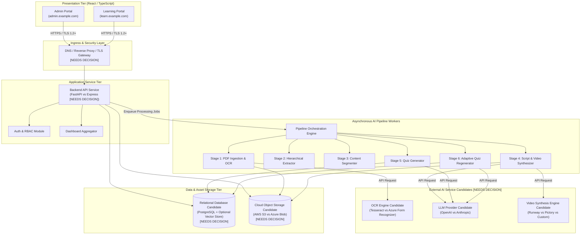

# 09 — Deployment Specification

## 1. Document Information

| Field            | Value                                                                                  |
| ---------------- | -------------------------------------------------------------------------------------- |
| **Document**     | 09_DEPLOYMENT.md                                                                       |
| **Project**      | AI-Powered Textbook-to-Video Learning & Student Performance Platform                   |
| **Version**      | 1.0                                                                                    |
| **Status**       | Proposed Deployment Specification — Pending Review                                     |
| **Sequence**     | Document 9 of the project documentation series                                         |
| **Predecessors** | 01_PRD v1.0, 02_REQUIREMENTS v1.2, 03_SYSTEM_ARCHITECTURE v1.0, 04_DATABASE v1.0, 05_API v1.0, 06_UI_UX v1.0, 07_SECURITY v1.0, 08_TESTING v1.0 |

> [!IMPORTANT]
> This document is a **proposed deployment specification**. No infrastructure has been provisioned, no deployments have been executed, and no operational claims are asserted as finalized. All deployment architectures, topologies, pipelines, and procedures described herein are **planned specifications** subject to final technology selections and architectural approval.

---

### 1.1 Purpose and Scope

This document specifies the deployment architecture, environment topology, infrastructure requirements, configuration management, security controls, CI/CD pipeline strategy, operational procedures, disaster recovery protocols, and deployment verification framework for the **AI-Powered Textbook-to-Video Learning & Student Performance Platform**.

The scope of this deployment specification encompasses:

- Infrastructure topology for the dual-portal web architecture (`admin.example.com` and `learn.example.com`).
- Deployment patterns for the six-stage AI content-processing pipeline (Stages 1–5 initial processing, admin review/approval gate, and Stage 6 post-publication adaptive quiz regeneration).
- Pre-rendered video asset storage and distribution topology (strictly prohibiting real-time video rendering during student playback).
- Environment isolation across Development, Testing, Staging, and Production tiers.
- Database and object storage deployment, secret management, and transport/at-rest security controls per `07_SECURITY.md`.
- Operational logging, health checks, monitoring, automated backups, and rollback procedures.
- Deployment verification mapped directly to planned test cases in `08_TESTING.md`.

---

## 2. Deployment Objectives

The deployment framework is designed to satisfy five core operational objectives:

1. **Dual-Domain Web Isolation**: Ensure strict separation and domain routing between the Administrator Portal (`admin.example.com`) and Student Learning Portal (`learn.example.com`), enforcing domain-scoped CORS and role-based access boundaries (CON-003, SEC-API-004, VER-009).
2. **Asynchronous Pipeline Reliability**: Support resilient, isolated background execution of the multi-stage content extraction and synthesis pipeline without impacting API responsiveness or student playback performance (ARCH Sec 3).
3. **Strict Content Governance**: Enforce an immutable deployment gate ensuring that AI-generated scripts, videos, and quizzes remain in a `pending_review` state and are never exposed to the student portal prior to explicit administrator approval (FR-007, REQ-FR-008, CON-002, SEC-AI-005, ARCH-V-004).
4. **Pre-Rendered Asset Delivery Efficiency**: Deliver pre-rendered ~5–6 minute video lessons via secure cloud object storage and distribution networks, guaranteeing zero live video generation overhead during student streaming (NFR-001, NFR-002, REQ-NFR-001, REQ-NFR-002, ARCH-V-005).
5. **Zero-Trust Infrastructure Security**: Maintain environment-level isolation, encrypted data transit/rest, zero hardcoded secrets, generic error responses, and read-only summary protections for parent/teacher dashboards (FR-012, REQ-FR-012, SEC-AUTHZ-004, SEC-SEC-001, SEC-ENC-001, ARCH-V-006).

---

## 3. Deployment Architecture Overview

The platform uses a multi-tier, decoupled deployment topology comprising web presentation, API backend, asynchronous pipeline workers, relational database, object storage, and external AI service integration.



---

## 4. Environments: Development, Testing, Staging, and Production

To prevent data contamination, accidental resource access, and security leaks, the platform mandates four strictly isolated deployment environments.

### 4.1 Environment Matrix

| Attribute | Development (DEV) | Testing (TEST) | Staging (STAG) | Production (PROD) |
| --- | --- | --- | --- | --- |
| **Purpose** | Local feature development and component testing | Automated integration, unit, and QA testing | Dry-run releases, UAT, and performance validation | Live service delivery for production users |
| **Admin Domain** | `admin.dev.local` | `admin.test.local` | `admin.staging.example.com` | `admin.example.com` |
| **Learning Domain** | `learn.dev.local` | `learn.test.local` | `learn.staging.example.com` | `learn.example.com` |
| **Data Isolation** | Synthetic local database; mock AI responses | Automated test database seeding (`TD-USERS`, `TD-PDF-VALID`) | Anonymized staging database; test storage bucket | Production database; encrypted production object storage |
| **AI Integration** | Mocked AI adapters or developer sandbox keys | Mocked AI adapters for deterministic test execution | Staging AI service accounts with strict rate limits | Dedicated production AI service accounts |
| **Secrets Management** | Local `.env.local` (git-ignored) | CI/CD pipeline secrets runner | Staging secret manager instance `[NEEDS DECISION]` | Production secret manager instance `[NEEDS DECISION]` |
| **Access Control** | Developer workstation access | Automated CI/CD service runner access | QA and Administrator preview access | Strict production IAM roles; least-privilege service accounts |

### 4.2 Environmental Isolation Rules

1. **Zero Credential Sharing**: Production credentials, database connection strings, and API keys must never be deployed or stored in DEV, TEST, or STAG environments (SEC-INFRA-001).
2. **Database Boundary**: Production database instances must reside in isolated virtual private networks inaccessible from non-production environments (SEC-INFRA-002).
3. **Mock Defaults for CI/CD**: Integration tests in TEST environment must rely on mocked external AI services to prevent non-deterministic pipeline behavior and unapproved API costs.

---

## 5. Application Deployment Topology

### 5.1 Presentation Tier Topology

- **Frontend Technology**: React with TypeScript (confirmed per NFR-004).
- **Build Artifacts**: Compiled, static Single-Page Application (SPA) bundles for `admin.example.com` and `learn.example.com`.
- **Deployment Pattern**: Static asset hosting behind a Content Delivery Network (CDN) or web server reverse proxy `[NEEDS DECISION]`.
- **Security Headers**: Production web servers must inject mandatory security headers (`Content-Security-Policy`, `X-Frame-Options`, `X-Content-Type-Options`, `Referrer-Policy`, `Strict-Transport-Security`) on all asset responses.

### 5.2 Application Service Tier Topology

- **Backend Architecture**: RESTful API service supporting the 17 endpoints defined in `05_API.md`. Backend language and framework candidate `[NEEDS DECISION]` (FastAPI vs Express per NFR-003).
- **Process Management**: Stateless backend application instances deployed behind a load balancer / reverse proxy.
- **Worker Process Decoupling**: Processing-heavy pipeline operations (PDF extraction, video synthesis job polling, quiz generation) run in dedicated worker process pools decoupled from the HTTP server loop, ensuring API responsiveness.

---

## 6. Admin and Student Portal Domains

The platform architecture mandates strict domain and network boundary separation between administrator and student entry points (CON-003).

```
                       +-----------------------------------+
                       |      DNS / Edge Load Balancer     |
                       +-----------------------------------+
                                 /               \
                                /                 \
  +-----------------------------------+     +-----------------------------------+
  |       admin.example.com           |     |       learn.example.com           |
  |  (Administrator Portal Workspace) |     | (Student Learning & Parent Dash)  |
  +-----------------------------------+     +-----------------------------------+
  | - PDF Textbook Upload (FR-001)    |     | - Video Playback (FR-010, NFR-002)|
  | - Pipeline Execution Monitor      |     | - Topic Quizzes (FR-006)          |
  | - Hierarchy Review (FR-003)       |     | - Basic Adaptive Quiz (FR-011)    |
  | - Content Review & Gate (FR-007)  |     | - Read-Only Parent Dash (FR-012)  |
  | - User Account Mgmt (FR-008)      |     | - Read-Only Teacher Dash (FR-012) |
  | - Mastery Threshold Config (FR-009)|    +-----------------------------------+
  +-----------------------------------+
```

### 6.1 Domain Routing and CORS Rules

- **`admin.example.com`**:
  - Directs traffic exclusively to Admin Portal frontend static assets and `/admin/*` API routes.
  - CORS policy strictly restricts origin to `https://admin.example.com` (SEC-API-004, VER-009).
  - Admin endpoints reject non-administrator credentials with an access denied response (`403` illustrative `[NEEDS DECISION]`) (SEC-AUTHZ-002).
- **`learn.example.com`**:
  - Directs traffic to Learning Portal static assets and `/learn/*` API routes.
  - CORS policy strictly restricts origin to `https://learn.example.com` (SEC-API-004, VER-009).
  - Learning endpoints enforce student ownership and prevent access to `/admin/*` routes (SEC-AUTHZ-003).

---

## 7. Backend and Processing Services

### 7.1 Backend API Service Deployment

- **Endpoint Routing**: Serves 11 Admin endpoints (`/admin/*`) and 6 Learning endpoints (`/learn/*`).
- **Framework Candidate**: `[NEEDS DECISION]` — FastAPI (Python) versus Express (Node.js/TypeScript) per NFR-003.
- **Container / Process Execution**: Stateless execution container or application process instance `[NEEDS DECISION]`.
- **Scaling Group**: Auto-scaling instance group based on CPU and request latency thresholds `[NEEDS DECISION]`.

### 7.2 Async Processing Pipeline Worker Deployment

- **Task Queue Architecture**: Distributed queue / task broker `[NEEDS DECISION]` managing asynchronous stage execution jobs.
- **Execution Isolation**: Pipeline workers run in containerized or process-isolated sandboxes with constrained memory, filesystem, and network permissions to prevent malformed PDF exploits from compromising host services (SEC-FILE-005).
- **Timeout and Resource Enforcement**: Workers enforce hard limits on memory allocation and execution time per stage (e.g. OCR parser timeouts) to prevent resource exhaustion attacks (SEC-FILE-006).

---

## 8. Database and Data-Storage Deployment

### 8.1 Relational Database Engine

- **Candidate Selection**: PostgreSQL is confirmed as the primary relational database candidate (per NFR-009 and 04_DATABASE.md). The specific managed instance service, physical topology, and version remain `[NEEDS DECISION]`.
- **Entities Deployed**: Stores `E-USER`, `E-TEXTBOOK`, `E-HIERARCHY`, `E-VIDEO`, `E-QUIZ`, `E-QUESTION`, `E-REVIEW-STATUS`, `E-QUIZ-ATTEMPT`, `E-MASTERY`, `E-ADAPTIVE-ITEM`, and `E-SYSTEM-SETTINGS`.
- **Network Isolation**: Database instances must reside in private subnets without public IP addresses (SEC-INFRA-002). Access is granted strictly to authenticated backend application services via encrypted connections.

### 8.2 Optional Vector Store Candidate

- **Candidate Selection**: An optional vector store for semantic feature retrieval remains `[NEEDS DECISION]` per NFR-009 and 04_DATABASE.md Sec 10.
- **Deployment Provision**: If selected during detailed design, the vector store will be deployed in the private application subnet alongside the primary database.

### 8.3 Cloud Object Storage Deployment

- **Candidate Selection**: Cloud Object Storage provider candidate `[NEEDS DECISION]` (AWS S3 vs Azure Blob Storage per NFR-008).
- **Bucket Structure**:
  - `textbook-uploads/` — Uploaded raw PDF binaries (private access; non-public).
  - `extracted-assets/` — Intermediate image assets and clean text extractions.
  - `video-lessons/` — Pre-rendered ~5–6 minute MP4 video lesson files (private bucket; delivery via signed URLs or CDN).
  - `narration-scripts/` — Audio assets and narration script text files.
- **Access Control**: Bucket permissions enforce public-read denial (`Private` ACL). Direct public URL access to raw PDFs, videos, or scripts is strictly prohibited (SEC-FILE-003, SEC-FILE-007, TR-011). Playback references are signed by the backend API.

---

## 9. Textbook PDF Ingestion and Processing Pipeline Deployment

The platform deploys a six-stage content pipeline structured around a mandatory administrator review gate.

```
[ Stage 1: PDF Ingestion & OCR ] 
               │
               ▼
[ Stage 2: Hierarchical Extraction ]
               │
               ▼
[ Stage 3: Content Segmentation (~5-6 min) ]
               │
               ▼
[ Stage 4: Script & Pre-Rendered Video Synthesis ]
               │
               ▼
[ Stage 5: Topic Quiz Generation ]
               │
               ▼
     =================================================
     MANDATORY ADMIN REVIEW & APPROVAL GATE (CON-002)
     Items in pending_review status (E-REVIEW-STATUS)
     =================================================
               │
               ├───────────────────────────────┐
               │ (Approval Succeeds)           │ (Rejection [NEEDS CONFIRMATION])
               ▼                               ▼
    [ PUBLISHED Content ]             [ Held / Retried ]
               │
               ▼
   Student Playback & Quiz Attempts
               │
               ▼
[ Stage 6: Post-Publication Adaptive Quiz Regeneration ]
```

### 9.1 Stage-by-Stage Deployment Requirements

| Pipeline Stage | Candidate Tech / Provider | Deployment & Security Controls | Traces To |
| --- | --- | --- | --- |
| **Stage 1: PDF Ingestion & OCR** | Candidate OCR Engine `[NEEDS DECISION]` (Tesseract vs Azure Form Recognizer per NFR-005) | Enforce `.pdf` extension & `application/pdf` MIME check (SEC-FILE-001); validate file size limit `[NEEDS DECISION]` (SEC-FILE-002); verify `%PDF-` magic bytes (SEC-FILE-003); inspect active content (SEC-FILE-004); execute parser in isolated container sandbox (SEC-FILE-005). | FR-001, FR-002, REQ-FR-001, REQ-FR-002, CON-001, CDR-002 |
| **Stage 2: Hierarchical Extraction** | Backend extraction parser service | Parse text into chapters, topics, and subtopics; persist tree to `E-HIERARCHY`. | FR-003, REQ-FR-003, CDR-003 |
| **Stage 3: Content Segmentation** | Segmentation logic module | Segment content into discrete learning units targeting ~5–6 minute video durations. | FR-004, REQ-FR-004, NFR-001, REQ-NFR-001 |
| **Stage 4: Script & Video Synthesis** | LLM Candidate `[NEEDS DECISION]` (OpenAI vs Anthropic); Video Engine Candidate `[NEEDS DECISION]` (Runway vs Pictory vs Custom) | Separate textbook text from system prompts via structured message boundaries (SEC-AI-001); sanitize script text before storage (SEC-AI-002); enforce token limits (SEC-AI-004); pre-render video files to object storage (NFR-002, REQ-NFR-002). | FR-005, REQ-FR-005, NFR-001, NFR-002, REQ-NFR-001, REQ-NFR-002, CDR-004, SEC-AI-001, SEC-AI-002 |
| **Stage 5: Topic Quiz Generation** | LLM Candidate `[NEEDS DECISION]` (OpenAI vs Anthropic) | Generate topic quizzes aligned to learning objectives; validate question schema against strict JSON definitions before database persistence (SEC-AI-004); store in `E-QUIZ` and `E-QUESTION`. | FR-006, REQ-FR-006, CDR-005, SEC-AI-004 |
| **Admin Review Gate** | Admin Review Controller (`/admin/review/*`) | All generated content placed in `pending_review` status (`E-REVIEW-STATUS`). Content remains strictly un-published and unavailable to students until administrator approves via `POST /admin/review/items/{id}/approval`. | FR-007, REQ-FR-008, CON-002, CDR-006, SEC-AI-005, ARCH-V-004 |
| **Stage 6: Adaptive Quiz Regeneration** | LLM Candidate `[NEEDS DECISION]` & Adaptive Engine | Post-publication execution: when students complete video/quiz attempts (`E-QUIZ-ATTEMPT`), the system generates targeted adaptive questions for weak concepts (`E-ADAPTIVE-ITEM`). Does NOT trigger live video rendering or alter pre-rendered videos. | FR-011, REQ-FR-007, CDR-008 |

---

## 10. Pre-Rendered Video Storage and Delivery

### 10.1 Pre-Rendered Video Constraint Enforcement

The system architecture strictly mandates that video lessons are pre-rendered during initial pipeline Stage 4 processing (NFR-002, REQ-NFR-002). The deployment topology must enforce the following boundaries:

1. **Zero Real-Time Video Rendering**: Student playback requests (`GET /learn/videos/{id}`) must fetch existing pre-rendered static video files. No real-time video generation or live AI video synthesis may be triggered during student playback.
2. **Duration Compliance**: Video assets must be verified during Stage 4 synthesis to target approximately 5–6 minutes per unit (NFR-001, REQ-NFR-001).

### 10.2 Delivery Topology

- **Storage Location**: Pre-rendered MP4 video files stored in private cloud object storage buckets (`[NEEDS DECISION]` AWS S3 vs Azure Blob per NFR-008).
- **Delivery Mechanism**: Pre-rendered video files are delivered via temporary, time-bound signed URLs generated by the API service or CDN edge distribution `[NEEDS DECISION]`.
- **Browser Playback**: Served via standard HTTP range requests supporting HTML5 video playback without requiring custom browser plugins or executing untrusted client scripts.

---

## 11. Configuration and Secrets Management

### 11.1 Configuration Management

- Environment configuration settings (domain names, CORS origins, debug flags, non-sensitive threshold defaults) are injected via standard environment configuration files.
- Application code must remain configuration-agnostic and read settings dynamically from the environment.

### 11.2 Secret Storage and Injection Controls

- **Zero Hardcoded Secrets**: Database passwords, signing keys, session secrets, and external AI service API keys (LLM provider, OCR engine, video synthesis engine) must NEVER be committed to source control or included in frontend client bundles (SEC-SEC-001, SEC-AI-003, VER-010).
- **Secret Manager Integration**: Production secrets must be stored in a dedicated cloud secret management service `[NEEDS DECISION]` and injected securely into backend API and worker process environments at startup.
- **Client Bundle Isolation**: Build tools must ensure no environment variables containing service keys or backend credentials are compiled into the static JavaScript bundles for `admin.example.com` or `learn.example.com` (SEC-SEC-001, SEC-AI-003).
- **Secret Rotation**: Target periodic rotation policies for token signing keys, database credentials, and external API tokens (SEC-SEC-002 `[NEEDS DECISION]`).

---

## 12. Authentication, Authorization, and Security Controls

### 12.1 Transport Layer Security (TLS)

- **TLS Version**: All external client-to-server traffic across `admin.example.com` and `learn.example.com` targets Transport Layer Security (TLS 1.2 or TLS 1.3) (SEC-ENC-001 `[NEEDS DECISION]`, VER-008).
- **HTTPS Enforcement**: Plaintext HTTP requests must automatically redirect to HTTPS.
- **Certificate Management**: Automated TLS certificate provision and renewal `[NEEDS DECISION]`.

### 12.2 Authentication and Session Management

- **Endpoint Protection**: Authentication is mandatory for all non-public API endpoints (SEC-AUTH-001, VER-001).
- **Credential Storage**: Passwords stored using a one-way adaptive hashing algorithm (e.g. bcrypt or Argon2 per SEC-AUTH-003 `[NEEDS DECISION]`, SEC-PRIV-002, VER-004). Plaintext password storage is strictly prohibited.
- **Session Expiration & Logout**: Enforce maximum session lifetimes and provide server-side session invalidation upon user logout (SEC-AUTH-002, SEC-AUTH-003).

### 12.3 Role-Based Access Control (RBAC) Enforcement

- **Admin Boundaries**: Endpoints under `/admin/*` are restricted strictly to authenticated users with the Administrator role (SEC-AUTHZ-001, SEC-AUTHZ-002, VER-002).
- **Student Boundaries**: Endpoints under `/learn/*` enforce student ownership checks on progress and quiz attempt data (SEC-AUTHZ-003).
- **Parent / Teacher Dashboard Access**: Parent and teacher account access is strictly restricted to read-only progress and mastery summaries via `GET /learn/dashboards/progress` (FR-012, REQ-FR-012, SEC-AUTHZ-004, ARCH-V-006). Direct access to raw video-progress logs (`E-VIDEO-PROGRESS`), individual quiz attempt answer logs (`E-QUIZ-ATTEMPT`), or raw PDF files is strictly denied. The parent/teacher-to-student association validation mechanism remains `[NEEDS CONFIRMATION]`.

### 12.4 Ingestion and File Security Controls

- **Extension & MIME Check**: Accept `.pdf` extension and `application/pdf` MIME type only (SEC-FILE-001, VER-005).
- **File Size Limit**: Enforce maximum upload file size at ingress `[NEEDS DECISION]` (SEC-FILE-002, VER-005).
- **Magic Bytes & Active Content**: Verify `%PDF-` magic bytes (SEC-FILE-003) and safely inspect active content (JavaScript actions, launch scripts, embedded files) per SEC-FILE-004 (VER-005).
- **Sandboxed Execution**: OCR and text parsing run in isolated container contexts with restricted privileges (SEC-FILE-005). Browser execution of PDFs is prohibited (SEC-FILE-006).
- **Temp File Purging**: Temporary files created during pipeline stages must be automatically deleted upon stage completion or failure (SEC-FILE-008).

### 12.5 AI Pipeline Security Controls

- **Prompt Boundary Isolation**: Extracted text is passed to LLM services using provider-supported structured message boundaries to mitigate indirect prompt injection (SEC-AI-001, VER-006, TR-005).
- **Output Validation**: LLM-generated scripts and quiz questions must be sanitized and validated against strict schemas before database persistence (SEC-AI-002, SEC-AI-004, VER-006).

---

## 13. Logging, Monitoring, Health Checks, and Alerting

### 13.1 Server-Side Logging Requirements

- **Logged Events**: System logs must record authentication attempts (SEC-LOG-001), authorization failure events (SEC-LOG-002), admin approval decisions, and pipeline stage failures.
- **Sensitive Data Exclusion**: Log entries must strictly exclude plaintext passwords, bearer tokens, session keys, raw student answer text, and unnecessary PII (SEC-LOG-003, VER-006). Log output targets tamper-evident, append-only storage `[NEEDS DECISION]`.

### 13.2 Health Check Endpoints

- **`/health/liveness`**: Returns `200 OK` if the backend HTTP service process is running.
- **`/health/readiness`**: Returns `200 OK` if backend service can successfully query the primary relational database and reach the object storage endpoint.

### 13.3 Monitoring and Alerting

- **Monitoring Targets**: Monitor backend API response latency, HTTP `5xx` error rates, background task queue depth, database connection pool saturation, and storage capacity.
- **Security Alerts**: Automated alert triggers for authentication failure spikes (SEC-MON-001 `[NEEDS DECISION]`) and elevated pipeline stage failure rates (SEC-MON-002 `[NEEDS DECISION]`).

---

## 14. Backup, Restoration, and Disaster Recovery

### 14.1 Database Backup Strategy

- **Automated Snapshots**: Daily automated full database backups with point-in-time recovery (PITR) enabled `[NEEDS DECISION]`.
- **Backup Encryption**: Database backup snapshots encrypted at rest using AES-256 or cloud key management services (SEC-INFRA-003 `[NEEDS DECISION]`).
- **Retention Schedule**: Backup retention policy `[NEEDS DECISION]` (e.g. 30-day retention for production snapshots).

### 14.2 Object Storage Resilience

- **Replication**: Cloud object storage buckets configured with cross-region replication or multi-zone redundancy `[NEEDS DECISION]` to protect uploaded PDFs and pre-rendered video assets.
- **Bucket Versioning**: Enabled on asset buckets to prevent accidental deletion or overwriting.

### 14.3 Disaster Recovery and Testing

- **Recovery Objectives**: Target Recovery Time Objective (RTO) and Recovery Point Objective (RPO) definitions `[NEEDS DECISION]`.
- **Restoration Drills**: Planned periodic database restoration drills in the STAG environment to verify snapshot integrity and recovery procedures.

---

## 15. CI/CD and Release Strategy

```
[ Developer Commit / PR ]
           │
           ▼
[ CI Pipeline Execution ] ──► Linting, Type Check, Build Compilation
           │
           ▼
[ Automated Test Suite ]  ──► Unit & Integration Tests (08_TESTING.md)
           │
           ▼
[ Artifact Generation ]   ──► Container Images / Frontend Bundles
           │
           ▼
[ Staging Deployment ]    ──► Deploy to STAG Environment
           │
           ▼
[ Staging Verification ]  ──► Automated Health Checks & Dry-Run Tests
           │
           ▼
[ Production Release ]    ──► Blue-Green / Rolling Cutover [NEEDS DECISION]
```

### 15.1 Continuous Integration (CI)

- **Trigger**: Pull requests and commits to main branches.
- **CI Tasks**:
  1. Static code analysis, linting, and TypeScript compilation.
  2. Execution of unit test suite (per `08_TESTING.md` Sec 4.1).
  3. Execution of integration test suite with mocked AI services (per `08_TESTING.md` Sec 4.2).
  4. Security scanning for hardcoded secrets and vulnerable dependencies (SEC-SEC-001, VER-010).
- **CI Provider**: Candidate CI tool `[NEEDS DECISION]`.

### 15.2 Deployment Strategy

- **Staging Gate**: All release candidates must deploy successfully to the STAG environment and pass automated health checks before production deployment.
- **Production Cutover Pattern**: Blue-Green or Rolling deployment pattern `[NEEDS DECISION]` ensuring zero-downtime cutover for `admin.example.com` and `learn.example.com`.

---

## 16. Deployment and Rollback Procedures

### 16.1 Proposed Production Deployment Procedure

1. **Pre-Deployment Sign-Off**: Verify that the release candidate has passed all CI checks and staging acceptance tests.
2. **Database Migration Dry-Run**: Execute database schema migration scripts in dry-run mode against a staging copy to verify backwards compatibility.
3. **Secret Provisioning**: Ensure all required environment variables and production secrets are populated in the secret manager (SEC-SEC-001).
4. **Backend & Worker Deployment**: Deploy updated backend API and worker processes to the idle production environment (Blue environment).
5. **Database Migration Execution**: Execute schema migrations.
6. **Frontend Asset Deployment**: Deploy updated static SPA bundles for `admin.example.com` and `learn.example.com` to staging storage / CDN.
7. **Health Check Verification**: Execute `/health/readiness` checks against Blue application instances.
8. **Traffic Cutover**: Update edge router / DNS to direct live traffic to Blue environment.
9. **Post-Deployment Monitoring**: Monitor error logs and system latency for 30 minutes following cutover.

### 16.2 Proposed Production Rollback Procedure

1. **Trigger Condition**: Initiated automatically if `/health/readiness` fails post-cutover or if HTTP `5xx` error rates exceed 1% over a 5-minute window.
2. **Traffic Redirection**: Immediately update edge router / DNS to route live traffic back to the previous stable environment (Green environment).
3. **Worker Rollback**: Revert background worker queues to process jobs using the previous stable version.
4. **Database Rollback**: Execute reverse database migration scripts if schema changes were introduced, or restore database state from pre-deployment snapshot if data corruption occurred.
5. **Post-Mortem Capture**: Lock deployment logs and generate an incident report for root-cause analysis.

---

## 17. Scaling and Performance Considerations

### 17.1 Scaling Strategies

- **Stateless API Tier**: Backend API instances scale horizontally based on CPU utilization and HTTP concurrency `[NEEDS DECISION]`.
- **Pipeline Worker Tier**: Async pipeline worker pools scale dynamically based on task queue depth `[NEEDS DECISION]`.
- **Pre-Rendered Video Delivery Offloading**: Video streaming bandwidth is fully offloaded to cloud object storage and CDN, protecting the core application API from video transport bottlenecks.

### 17.2 Performance SLA and Benchmark Status

- **Status**: **Deferred** — Performance benchmarks, SLAs, and load testing thresholds are not defined in the baseline architecture (per Architecture Sec 10.2).
- **Target Baseline**: Detailed performance targets and load testing thresholds will be established in Phase 4 per the project roadmap.

---

## 18. Testing and Deployment Verification

Deployment verification aligns directly with the planned test cases in `08_TESTING.md` and the security targets in `07_SECURITY.md`.

### 18.1 Post-Deployment Verification Matrix

| Verification Target | Target Description | Verification Method | Traced Test Cases (`08_TESTING.md`) |
| --- | --- | --- | --- |
| **VER-001** | Authentication required on all non-public endpoints | Send unauthenticated request to `/admin/*` and `/learn/*` routes; assert authentication required response (`401` illustrative `[NEEDS DECISION]`). | TC-AUTH-001, TC-LEARN-006, TC-DASH-006, TC-SEC-020 |
| **VER-002** | Role-based access control enforcement | Send request with Student credentials to `/admin/users` and `/admin/review/items`; assert access denied response (`403` illustrative `[NEEDS DECISION]`). | TC-AUTHZ-002, TC-AUTHZ-003, TC-AUTHZ-004, TC-ADMIN-005, TC-ADMIN-013 |
| **VER-003** | Parent/Teacher summary-only access | Query `GET /learn/dashboards/progress` with Parent/Teacher token; assert response contains aggregated progress only; verify no raw quiz attempts or video logs returned. | TC-DASH-001, TC-DASH-002, TC-DASH-003, TC-DB-012 |
| **VER-004** | Password adaptive hashing | Inspect production database user records (`E-USER`); assert passwords stored as adaptive hashes (bcrypt/Argon2); verify zero plaintext passwords in DB or logs. | TC-SEC-031, TC-LOG-003, TC-SEC-043 |
| **VER-005** | PDF upload format & active content check | Attempt upload of non-PDF file, oversized file, and PDF with JavaScript actions; verify validation rejection and safe active content handling. | TC-PIPE-001–005, TC-SEC-001–003 |
| **VER-006** | Prompt boundary isolation & LLM output sanitization | Inspect LLM API request payloads for structured message boundaries; verify LLM script/quiz outputs are sanitized and schema-validated before DB storage. | TC-PIPE-043, TC-PIPE-044, TC-PIPE-052, TC-SEC-010, TC-SEC-011 |
| **VER-007** | Admin approval gate enforcement | Trigger pipeline Stages 1–5; verify generated content enters `pending_review` state (`E-REVIEW-STATUS`); verify content is un-retrievable on Student Portal until admin approves. | TC-PIPE-074, TC-ADMIN-003, TC-ADMIN-004, TC-LEARN-005, TC-SEC-013 |
| **VER-008** | Error response sanitization | Trigger server error (`500`) and bad input (`400`); verify API returns generic error message without stack traces, SQL queries, or internal file paths. | TC-SEC-021, TC-PRIV-003, TC-SEC-020 |
| **VER-009** | CORS domain restriction | Send cross-origin request from unauthorized origin; verify CORS policy blocks request; verify origins restricted to `admin.example.com` and `learn.example.com`. | TC-SEC-022, TC-API-004 |
| **VER-010** | Secrets exclusion verification | Scan client JavaScript bundles, source code, and deployment logs; verify zero hardcoded credentials, token signing keys, or AI service API keys present. | TC-SEC-012, TC-SEC-032, TC-SEC-033, TC-SEC-043 |

---

## 19. Risks, Assumptions, Dependencies, and Open Decisions

### 19.1 Unresolved Technology Decisions (`[NEEDS DECISION]`)

The following technology selections remain unresolved in the project baseline and are marked `[NEEDS DECISION]`. Deployment planning accounts for these candidates without forcing an unapproved choice:

1. **Backend Language & Framework**: FastAPI (Python) vs Express (Node.js/TypeScript) (PRD NFR-003, Architecture Sec 10.1).
2. **OCR Engine Service**: Tesseract vs Azure Form Recognizer (PRD NFR-005, Architecture Sec 10.1).
3. **LLM Service Provider**: OpenAI vs Anthropic (PRD NFR-006, Architecture Sec 10.1).
4. **Text-to-Video Engine**: Runway vs Pictory vs Custom Synthesis Pipeline (PRD NFR-007, Architecture Sec 10.1).
5. **Cloud Object Storage Provider**: AWS S3 vs Azure Blob Storage (PRD NFR-008, Architecture Sec 10.1).
6. **Database Instance Topology & Vector Store Candidate**: PostgreSQL managed service topology and optional vector store candidate (PRD NFR-009, 04_DATABASE.md Sec 10.1).
7. **Infrastructure Hosting Provider & Platform Topology**: Container orchestration (Kubernetes/ECS) vs PaaS/Serverless deployment platform `[NEEDS DECISION]`.
8. **CI/CD Tooling & Infrastructure-as-Code (IaC) Framework**: CI runner and IaC framework selection `[NEEDS DECISION]`.

### 19.2 Operational Risks and Mitigations

| Risk | Impact | Mitigation Strategy |
| --- | --- | --- |
| External AI Service Rate Limiting / Outage | Pipeline Stage 4/5 stall | Decouple pipeline via async worker queues; implement retry backoff; alert on queue backlog (SEC-MON-002 `[NEEDS DECISION]`). |
| Oversized / Malicious PDF Ingestion Attack | Worker resource exhaustion / exploit | Enforce upload size limits (SEC-FILE-002), magic byte validation (SEC-FILE-003), active content handling (SEC-FILE-004), and isolated worker container sandboxing (SEC-FILE-005). |
| Unintended Publication of Unapproved Content | Inappropriate AI content reaches students | Enforce mandatory database constraint requiring `published` status set exclusively via successful admin approval API call (`POST /admin/review/items/{id}/approval`) (CON-002, SEC-AI-005, ARCH-V-004). |
| Pre-Rendered Video Bandwidth Exhaustion | Student video streaming latency | Offload video streaming to cloud object storage signed URLs / CDN; serve static MP4 files only (NFR-002, ARCH-V-005). |

---

## 20. Traceability to Existing Requirements and Architecture

This matrix maps deployment specifications to locked requirements, architecture checks, database requirements, security controls, and planned test cases.

| Requirement / Component ID | Source Document & Section | Description | Deployment Provision | Traced Test / Verification |
| --- | --- | --- | --- | --- |
| **FR-001 / REQ-FR-001** | PRD Sec 12 / SRS Sec 3.1 | PDF Textbook Upload | Admin Portal upload interface on `admin.example.com`; Stage 1 PDF ingestion boundary. | TC-PIPE-001, VER-005 |
| **FR-002 / REQ-FR-002** | PRD Sec 12 / SRS Sec 3.1 | OCR Text Extraction | Async Stage 1 worker pool using Candidate OCR Engine `[NEEDS DECISION]`. | TC-PIPE-010, TC-PIPE-011 |
| **FR-003 / REQ-FR-003** | PRD Sec 12 / SRS Sec 3.1 | Hierarchical Content Extraction | Stage 2 extraction worker storing chapter/topic tree in `E-HIERARCHY`. | TC-PIPE-020, TC-PIPE-021 |
| **FR-004 / REQ-FR-004** | PRD Sec 12 / SRS Sec 3.2 | Content Segmentation | Stage 3 worker segmenting content into ~5–6 min learning units. | TC-PIPE-030, TC-PIPE-031 |
| **FR-005 / REQ-FR-005** | PRD Sec 12 / SRS Sec 3.2 | Script & Video Synthesis | Stage 4 synthesis worker pre-rendering MP4 files to Object Storage `[NEEDS DECISION]`. | TC-PIPE-040, TC-PIPE-041 |
| **FR-006 / REQ-FR-006** | PRD Sec 12 / SRS Sec 3.3 | Topic Quiz Generation | Stage 5 worker generating topic quizzes aligned to learning objectives. | TC-PIPE-050, TC-PIPE-051 |
| **FR-007 / REQ-FR-008** | PRD Sec 12 / SRS Sec 3.4 | Admin Review & Approval | Review queue workspace; mandatory admin approval gate before student publishing. | TC-ADMIN-001–004, TC-PIPE-074, VER-007 |
| **FR-008 / REQ-FR-009** | PRD Sec 12 / SRS Sec 3.4 | User Management | Admin user management workspace on `admin.example.com` (`E-USER`). | TC-ADMIN-010, TC-ADMIN-011 |
| **FR-009 / REQ-FR-010** | PRD Sec 12 / SRS Sec 3.4 | Mastery Threshold Config | Threshold configuration workspace (`E-SYSTEM-SETTINGS`). | TC-ADMIN-020, TC-ADMIN-021 |
| **FR-010 / REQ-FR-011** | PRD Sec 12 / SRS Sec 3.5 | Student Learning Portal | Student Portal on `learn.example.com`; pre-rendered video player & quizzes. | TC-LEARN-001–004, TC-LEARN-030 |
| **FR-011 / REQ-FR-007** | PRD Sec 12 / SRS Sec 3.3 | Basic Adaptive Quiz Flow | Post-publication Stage 6 worker generating adaptive items (`E-ADAPTIVE-ITEM`). | TC-PIPE-060–062, TC-LEARN-020 |
| **FR-012 / REQ-FR-012** | PRD Sec 12 / SRS Sec 3.5 | Read-Only Parent/Teacher Dash | Read-only summary dashboard on `learn.example.com` (`E-MASTERY`). | TC-DASH-001–003, VER-003 |
| **NFR-001 / REQ-NFR-001** | PRD Sec 13 / SRS Sec 4 | Video Duration (~5–6 min) | Stage 4 worker enforces ~5–6 min video unit length target. | TC-PIPE-042, TC-LEARN-003 |
| **NFR-002 / REQ-NFR-002** | PRD Sec 13 / SRS Sec 4 | Pre-Rendered Video Constraint | Pre-rendered static MP4 storage; zero real-time video generation during playback. | TC-PIPE-041, TC-LEARN-002, VER-007 |
| **CON-001** | SRS Sec 6 | PDF-Only Input | Ingestion validation accepts `.pdf` files only. | TC-PIPE-002, VER-005 |
| **CON-002** | SRS Sec 6 | Pre-Rendered + Approval Gate | Content held in `pending_review` status until admin approves via API. | TC-PIPE-074, TC-ADMIN-003, VER-007 |
| **CON-003** | SRS Sec 6 | Dual-Application Architecture | Domain routing for `admin.example.com` and `learn.example.com`. | TC-UI-001, TC-UI-020, VER-009 |
| **CDR-001 – CDR-010** | 04_DATABASE.md Sec 4 | Data Requirements | Relational database schema deployment (`E-USER` through `E-SYSTEM-SETTINGS`). | TC-DB-001 – TC-DB-012 |
| **SEC-FILE-001 – 008** | 07_SECURITY.md Sec 8 | File Upload Security | MIME validation, magic bytes, active content inspection, worker sandboxing. | TC-SEC-001–006, VER-005 |
| **SEC-AI-001 – 007** | 07_SECURITY.md Sec 9 | AI Pipeline Security | Structured prompt separation, output schema validation, mandatory approval gate. | TC-SEC-010–013, VER-006, VER-007 |
| **SEC-SEC-001 – 002** | 07_SECURITY.md Sec 12 | Secrets Management | Zero hardcoded secrets; runtime secret manager injection; bundle scanning. | TC-SEC-032, TC-SEC-033, VER-010 |
| **ARCH-V-001 – 008** | 03_SYSTEM_ARCHITECTURE.md Sec 11 | Architecture Verification | Multi-tier deployment alignment; asynchronous worker decoupling; domain isolation. | TC-PIPE-071, TC-PIPE-074, ARCH-V-001–008 |

---

## 21. Deployment Readiness Checklist

This checklist defines mandatory pre-deployment verification tasks. All checks represent required verification tasks prior to production launch (no items represent proof of completed execution).

| # | Deployment Verification Check | Scope & Requirement Reference | Status |
| --- | --- | --- | --- |
| 1 | **Domain Separation Verified** | DNS and ingress routing configured for `admin.example.com` and `learn.example.com` (CON-003). | Planned Verification |
| 2 | **CORS Policy Verified** | CORS header restrictions verified to allow only approved portal origins (SEC-API-004, VER-009). | Planned Verification |
| 3 | **TLS 1.2+ Enforcement Verified** | HTTPS redirection and TLS 1.2+ protocol configuration verified on ingress gateway (SEC-ENC-001, VER-008). | Planned Verification |
| 4 | **Zero Hardcoded Secrets Verified** | Source code, git history, and client SPA builds scanned for hardcoded credentials or API keys (SEC-SEC-001, SEC-AI-003, VER-010). | Planned Verification |
| 5 | **Environment Secrets Injection Verified** | Production secret manager configured to inject database passwords and API keys at runtime (SEC-SEC-001). | Planned Verification |
| 6 | **Database Access Restriction Verified** | Primary database placed in private subnet with public IP access disabled (SEC-INFRA-002). | Planned Verification |
| 7 | **Object Storage Privacy Verified** | Cloud object storage buckets configured with public-read denial and signed URL access (SEC-FILE-003, SEC-FILE-007, TR-011). | Planned Verification |
| 8 | **PDF Upload Validation Verified** | MIME validation (`application/pdf`), magic byte check (`%PDF-`), and active content inspection active (SEC-FILE-001–004, VER-005). | Planned Verification |
| 9 | **Isolated Worker Sandbox Verified** | OCR and PDF text extraction processes running in sandboxed worker containers (SEC-FILE-005). | Planned Verification |
| 10 | **Admin Approval Gate Enforced** | Database and API rules verified to prevent unapproved content from appearing on `learn.example.com` (CON-002, SEC-AI-005, ARCH-V-004, VER-007). | Planned Verification |
| 11 | **Pre-Rendered Video Delivery Verified** | Playback endpoints verified to serve static pre-rendered MP4 files with zero live video rendering (NFR-002, REQ-NFR-002, ARCH-V-005). | Planned Verification |
| 12 | **Parent/Teacher Read-Only Verified** | Parent/Teacher dashboard endpoints verified to return read-only summaries only (FR-012, REQ-FR-012, SEC-AUTHZ-004, ARCH-V-006, VER-003). | Planned Verification |
| 13 | **Log Sensitive Data Exclusion Verified** | Server log output audited to ensure zero passwords, bearer tokens, or student PII are logged (SEC-LOG-003, VER-006). | Planned Verification |
| 14 | **Automated Database Backup Verified** | Encrypted automated database backups and PITR recovery mechanisms verified (SEC-INFRA-003). | Planned Verification |
| 15 | **Health Checks & Monitoring Verified** | `/health/readiness` endpoints and basic alerting triggers verified in STAG environment prior to PROD cutover. | Planned Verification |

---

## 22. Revision History

| Version | Date | Status | Description of Changes |
| --- | --- | --- | --- |
| **1.0** | 2026-10-11 | Proposed Deployment Specification — Pending Review | Initial proposed deployment specification created. Establishes dual-portal domain topology (`admin.example.com` / `learn.example.com`), 6-stage AI pipeline deployment, admin approval gate enforcement, pre-rendered video storage delivery, environmental isolation rules, secret management, security controls, CI/CD strategy, disaster recovery protocols, and verification mapping to `08_TESTING.md`. Preserves all 8 unresolved candidate technology decisions as `[NEEDS DECISION]`. |

---

*End of document — 09_DEPLOYMENT.md v1.0*
